# MJ-X — ARCHITECTURAL CONFLICTS, CORRECTIONS & RISK MITIGATIONS

This document identifies specific technical conflicts between the proposed master architecture and the existing MJ-X repository, providing precise engineering corrections and risk mitigation strategies.

---

## 1. INVENTORY OF IDENTIFIED CONFLICTS & CORRECTIONS

```mermaid
graph TD
    subgraph Conflict_1["1. Phonetic Search Collision Risk"]
        C1["Stonic's Consonant-Skeleton (*_skel) Strips All Vowels"]
        Risk1["Massive false-positive collisions in Hindi/Urdu (pata / pita / poti -> 'pt')"]
        Fix1["Correction: Unicode NFKC + FTS5 Trigrams + Bounded Stemming"]
        C1 --> Risk1 --> Fix1
    end

    subgraph Conflict_2["2. QWebEngineView RAM Overhead"]
        C2["Visual Hub using embedded Chromium on ThinkPad T420"]
        Risk2["Consumes 200MB–250MB RAM on a 4GB system"]
        Fix2["Correction: Strict Lazy Loading (Imported only on explicit show_visual)"]
        C2 --> Risk2 --> Fix2
    end

    subgraph Conflict_3["3. Subprocess Monkey-Patch Removal"]
        C3["Removing lines 6-16 in main.py without updating 28 actions"]
        Risk3["Flashing black command prompt windows on Windows for every tool run"]
        Fix3["Correction: Introduce mjx.platform.process.safe_popen before patch removal"]
        C3 --> Risk3 --> Fix3
    end

    subgraph Conflict_4["4. Linux Wayland vs X11 Notch Transparency"]
        C4["Assuming click-through transparency works identically across OSes"]
        Risk4["Wayland compositors block arbitrary input masking and top-level docking"]
        Fix4["Correction: Platform detection with compact floating window fallback on Wayland"]
        C4 --> Risk4 --> Fix4
    end

    subgraph Conflict_5["5. Legacy Memory API Compatibility"]
        C5["Directly replacing memory_manager.py with new SQLite service"]
        Risk5["Breaks 12+ existing action modules calling loadMemory / saveMemory"]
        Fix5["Correction: Maintain backward-compatible adapter layer in memory_manager.py"]
        C5 --> Risk5 --> Fix5
    end
```

---

## 2. DEEP DIVE: CRITICAL CONFLICTS & CONCRETE CORRECTIONS

### CONFLICT 1: The "Consonant-Skeleton" Index Trap in Indo-Aryan Languages
- **The Proposal:** In Stonic AI analysis reports, a consonant-skeleton index (`*_skel`) was highlighted (e.g., stripping all vowels so `jana` -> `jn`).
- **Code Reality & Linguistic Conflict:** While consonant-only skeletons work tolerably well for Semitic roots (Arabic/Hebrew), in Indo-Aryan languages (Hindi and Urdu), vowels carry critical semantic differentiation. Stripping vowels creates catastrophic search collision rates:
  - `pata` (address), `pita` (father), `poti` (granddaughter), `peta` (belly), `peeta` (drinks) all reduce to the identical skeleton: **`pt`**.
  - A query for "pita ji ka phone number" would match notes regarding "pata", "poti", and "peeta", destroying retrieval precision.
- **Engineering Correction:**
  1. **Do NOT use naive consonant-skeleton stripping as a primary index.**
  2. Implement SQLite FTS5 using the **Unicode61** tokenizer combined with an auxiliary **Trigram (`tokenize='trigram'`)** virtual table.
  3. For Hinglish variations (e.g., "khush" vs "khoosh", "hai" vs "h", "bhai" vs "bro"), use a small, curated derived phonetic dictionary table (`phonetic_expansions`) evaluated at search query time, rather than corrupting the database index with lossy consonant stripping.

---

### CONFLICT 2: `QWebEngineView` Memory Exhaustion on 4GB ThinkPad T420
- **The Proposal:** Section 9.3 proposes a sandboxed `QWebEngineView` for the Visual Hub to render interactive charts and diagrams.
- **Hardware Conflict:** On the target Lenovo ThinkPad T420 (which often runs with 4GB of DDR3 RAM), importing and initializing `PyQt6.QtWebEngineWidgets` immediately spawns a multi-process Chromium rendering engine consuming **~200 MB to 250 MB of RAM**, instantly breaking our <120 MB RAM budget.
- **Engineering Correction:**
  1. The Visual Hub **must NOT be initialized at application startup**.
  2. It must be encapsulated inside a **lazy-loaded optional module** (`mjx/ui/visual_hub.py`).
  3. If the user never invokes `show_visual` during a session, `QWebEngineView` is never imported, and zero Chromium processes are spawned.
  4. Provide a lightweight fallback: for static charts and tables, render using native PyQt6 widgets (`QTableWidget`, `QLabel` with SVG/PNG) or export to a local HTML file opened in the user's default system browser.

---

### CONFLICT 3: Uncoordinated Subprocess Monkey-Patch Removal
- **The Proposal:** Section 5.1 and the security audit mandate removing lines 6–16 in `main.py`, which monkey-patch `subprocess.Popen` with `CREATE_NO_WINDOW`.
- **Codebase Conflict:** Over **28 action files** in `/home/obito/Documents/MJ-X/actions/` (e.g., `open_app.py`, `system_optimizer.py`, `notes_action.py`, `dev_agent.py`) execute external shell commands. Many of them rely on the global monkey-patch to suppress console windows on Windows. If lines 6–16 are deleted without first refactoring these actions, **a black terminal window will flash across the user's screen every time MJ-X checks system metrics, launches an app, or opens a file**.
- **Engineering Correction:**
  1. Create a centralized process utility: `mjx/platform/process.py` containing `safe_popen()` and `safe_run()`.
  2. Refactor existing action modules to call `safe_run()` which explicitly attaches `creationflags=subprocess.CREATE_NO_WINDOW` on Windows and appropriate process groups on Linux.
  3. Only after all action modules are updated should lines 6–16 in `main.py` be removed.

---

### CONFLICT 4: Desktop Presence Notch on Linux (Wayland vs. X11)
- **The Proposal:** Section 9.2 proposes a frameless top-docked compact presence widget with click-through transparency.
- **OS Platform Conflict:**
  - On Windows: Win32 layered windows (`WS_EX_TRANSPARENT | WS_EX_LAYERED`) handle click-through masking reliably.
  - On Linux X11: `XShape` masks or `Qt.WidgetAttribute.WA_TransparentForMouseEvents` allow clicks to pass through.
  - On Linux Wayland (Ubuntu default): Modern Wayland compositors (Mutter/GNOME) strictly forbid applications from positioning themselves at arbitrary screen coordinates or passing input events to underlying windows without explicit `wlr-layer-shell` protocols (which standard PyQt6 does not expose).
- **Engineering Correction:**
  1. Implement runtime display server detection at boot (`X11` vs `Wayland` vs `Windows`).
  2. On Windows and Linux X11: Enable top-docked frameless pill with click-through transparency.
  3. On Linux Wayland: Gracefully degrade to a compact, movable floating pill window (`Qt.WindowType.Tool`) without assuming global click-through transparency.

---

### CONFLICT 5: Breaking Legacy Action Dependencies on `memory_manager.py`
- **The Proposal:** Section 4 proposes migrating to a new SQLite memory engine.
- **Codebase Conflict:** Currently, `main.py`, `ui.py`, and several actions directly import functions from `memory.memory_manager`:
  - `load_memory()`, `update_memory()`, `searchMemory()`, `format_memory_for_prompt()`, `save_session_summary()`.
  - Deleting or abruptly replacing `memory_manager.py` will break imports across the entire application simultaneously.
- **Engineering Correction:**
  1. Preserve `memory/memory_manager.py` as a **Compatibility Adapter**.
  2. Internally re-route its function calls to the new SQLite `MemoryService`.
  3. This ensures that legacy action files continue to work without a massive, risky multi-file refactoring sprint.

---

## 3. UNREALISTIC RECOMMENDATIONS & FEATURES TO POSTPONE

| Feature / Recommendation | Source in Audit/Master | Why It Is Unrealistic for Initial Release | Recommendation |
| :--- | :--- | :--- | :--- |
| **Multi-Device Cross-Cloud Sync** | Section 10 / ADR-007 | High cryptographic complexity (E2EE, CRDT conflict resolution); violates local-first simplicity. | **POSTPONE to v2.0** |
| **Autonomous Multi-Step Screen Workflows** | Section 8.1 / Autopilot | General vision models have high error rates; risk of accidental data deletion on live desktop. | **RESTRICT to Single-Step Approved Actions** |
| **Living Desktop Wallpaper (WorkerW)** | Stonic Reports | Extremely brittle Win32 private message hooks (`0x052C`) that crash on Windows 11 updates and do not exist on Linux. | **POSTPONE indefinitely** |
| **Always-Loaded Visual Hub** | Section 9.3 | Chromium engine permanently consumes 200MB+ RAM on low-spec hardware. | **RECLASSIFY as Lazy-Loaded Optional Plugin** |
