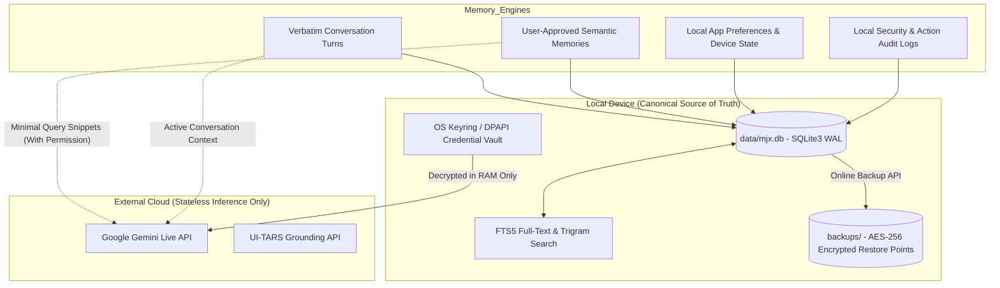
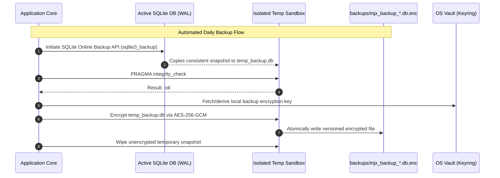

# MJ-X — LOCAL-FIRST DATA ARCHITECTURE & STORAGE SPECIFICATION
**Data Sovereignty Standard:** 100% Local Canonical Ownership  
**Primary Database:** SQLite3 with Write-Ahead Logging (WAL)  
**Security Standard:** OS Credential Vault + AES-256 Encrypted Backups  

---

## 1. DATA OWNERSHIP & TRUST PRINCIPLES

In MJ-X, **the local machine is the single source of truth**. Cloud AI providers (Google Gemini, Anthropic Claude, OpenRouter) are treated as **stateless compute engines**, never as canonical databases.



### Core Data Rules:
1. **Zero Cloud-Archived History:** Conversations are never sent to external servers for archival, storage, or telemetry.
2. **Context Minimization:** When querying cloud LLMs, only the minimum relevant conversation snippet and user-approved facts needed for the current prompt are transmitted.
3. **User-Controlled Data Lifecycle:** Complete data export to JSON/Markdown and one-click irreversible deletion must be accessible from the settings UI at all times.

---

## 2. SQLITE SCHEMA DESIGN & MIGRATION FRAMEWORK

The database resides at `data/mjx.db`. On connection, the engine executes:
```sql
PRAGMA journal_mode = WAL;          -- High-concurrency reads/writes without lock contention
PRAGMA synchronous = NORMAL;        -- Safe with WAL, maximizes I/O speed on SATA storage
PRAGMA foreign_keys = ON;          -- Enforces relational integrity
PRAGMA busy_timeout = 5000;         -- 5-second wait window before throwing SQLITE_BUSY
```

### 2.1. Canonical Relational Tables

```sql
-- 1. Schema Versioning for Safe, Forward-Only Migrations
CREATE TABLE IF NOT EXISTS schema_migrations (
    version INTEGER PRIMARY KEY,
    name TEXT NOT NULL,
    applied_at REAL NOT NULL,
    checksum TEXT NOT NULL
);

-- 2. Conversations & Sessions
CREATE TABLE IF NOT EXISTS conversations (
    id TEXT PRIMARY KEY,            -- UUID4 string
    title TEXT,                     -- Summarized session title
    channel TEXT NOT NULL,          -- 'desktop' | 'mobile_android' | 'dashboard'
    started_at REAL NOT NULL,
    ended_at REAL,
    digested_upto INTEGER DEFAULT 0 -- Tracks background memory summarization boundary
);

-- 3. Verbatim Message Turns (Immutable Ground Truth)
CREATE TABLE IF NOT EXISTS messages (
    id INTEGER PRIMARY KEY AUTOINCREMENT,
    conversation_id TEXT NOT NULL REFERENCES conversations(id) ON DELETE CASCADE,
    role TEXT NOT NULL,             -- 'user' | 'assistant' | 'tool'
    content TEXT NOT NULL,
    content_type TEXT DEFAULT 'text', -- 'text' | 'audio_transcript' | 'image_description'
    tool_name TEXT,                 -- Name of tool called (if role == 'tool')
    timestamp REAL NOT NULL
);
CREATE INDEX IF NOT EXISTS idx_messages_conv ON messages(conversation_id, timestamp);

-- 4. Durable User-Approved Memories (Semantic Facts & Preferences)
CREATE TABLE IF NOT EXISTS memories (
    id INTEGER PRIMARY KEY AUTOINCREMENT,
    category TEXT NOT NULL,         -- 'facts' | 'preferences' | 'identity' | 'work'
    key TEXT NOT NULL,              -- Semantic identifier e.g. 'user_coffee_preference'
    value TEXT NOT NULL,            -- Fact text e.g. 'Drinks black espresso without sugar'
    fold TEXT NOT NULL,             -- Normalized text (lowercased, stripped accents)
    source_message_id INTEGER REFERENCES messages(id) ON DELETE SET NULL,
    confidence REAL DEFAULT 0.8,    -- 0.0 to 1.0 confidence score
    importance INTEGER DEFAULT 5,   -- 1 (trivial) to 10 (critical)
    is_approved INTEGER DEFAULT 1,  -- 0 = proposed by AI, 1 = user approved
    is_archived INTEGER DEFAULT 0,
    created_at REAL NOT NULL,
    updated_at REAL NOT NULL
);
CREATE INDEX IF NOT EXISTS idx_memories_cat ON memories(category, is_archived);

-- 5. Action & Security Audit Log
CREATE TABLE IF NOT EXISTS security_audit_log (
    id INTEGER PRIMARY KEY AUTOINCREMENT,
    event_type TEXT NOT NULL,       -- 'tool_call' | 'approval_granted' | 'approval_denied' | 'vault_access' | 'safety_stop'
    target TEXT NOT NULL,           -- Tool name, file path, or URL
    arguments_sanitized TEXT,       -- Redacted arguments summary
    status TEXT NOT NULL,           -- 'success' | 'blocked' | 'error' | 'interrupted'
    timestamp REAL NOT NULL
);
CREATE INDEX IF NOT EXISTS idx_audit_time ON security_audit_log(timestamp);
```

### 2.2. Full-Text Search (FTS5) Virtual Tables & Triggers
To enable sub-millisecond retrieval across thousands of memories without corrupting Indo-Aryan vowels:
```sql
-- FTS5 Full-Text Table using standard Unicode61 tokenizer
CREATE VIRTUAL TABLE IF NOT EXISTS memories_fts USING fts5(
    key,
    value,
    fold,
    content='memories',
    content_rowid='id',
    tokenize='unicode61 remove_diacritics 2'
);

-- Trigram Table for Partial Phrase and Typo Matching
CREATE VIRTUAL TABLE IF NOT EXISTS memories_trigram USING fts5(
    fold,
    content='memories',
    content_rowid='id',
    tokenize='trigram'
);

-- Synchronization Triggers: Keeps FTS indices strictly aligned with the base table
CREATE TRIGGER IF NOT EXISTS trg_memories_ai AFTER INSERT ON memories BEGIN
    INSERT INTO memories_fts(rowid, key, value, fold) VALUES (new.id, new.key, new.value, new.fold);
    INSERT INTO memories_trigram(rowid, fold) VALUES (new.id, new.fold);
END;

CREATE TRIGGER IF NOT EXISTS trg_memories_ad AFTER DELETE ON memories BEGIN
    INSERT INTO memories_fts(memories_fts, rowid, key, value, fold) VALUES ('delete', old.id, old.key, old.value, old.fold);
    INSERT INTO memories_trigram(memories_trigram, rowid, fold) VALUES ('delete', old.id, old.fold);
END;

CREATE TRIGGER IF NOT EXISTS trg_memories_au AFTER UPDATE ON memories BEGIN
    INSERT INTO memories_fts(memories_fts, rowid, key, value, fold) VALUES ('delete', old.id, old.key, old.value, old.fold);
    INSERT INTO memories_fts(rowid, key, value, fold) VALUES (new.id, new.key, new.value, new.fold);
    INSERT INTO memories_trigram(memories_trigram, rowid, fold) VALUES ('delete', old.id, old.fold);
    INSERT INTO memories_trigram(rowid, fold) VALUES (new.id, new.fold);
END;
```

---

## 3. RELIABLE BACKUP & RESTORATION SPECIFICATION

A local-first system without a proven, verifiable backup and restore mechanism is a data liability. 



### 3.1. Online Snapshot API (Zero WAL Inconsistency)
- **Never copy active WAL files directly using `shutil.copy`** while the database is open; doing so risks capturing half-committed transactions.
- Use Python's native `sqlite3.Connection.backup()` API:
  ```python
  import sqlite3

  def create_backup(source_conn: sqlite3.Connection, target_path: Path) -> None:
      target_conn = sqlite3.connect(str(target_path))
      with target_conn:
          source_conn.backup(target_conn, pages=100)
      target_conn.close()
  ```

### 3.2. Automated Integrity Verification
Before a backup is sealed:
1. Open the newly created snapshot in a sandboxed connection.
2. Execute `PRAGMA integrity_check;` and verify the result is strictly `"ok"`.
3. Compute and store the SHA-256 checksum of the verified snapshot.

### 3.3. Tested Atomic Restoration (Zero-Data-Loss Swap)
To restore from a backup:
1. **Never overwrite the live database directly.**
2. Decrypt and restore the backup file to a temporary location: `data/mjx_restore_candidate.db`.
3. Run `PRAGMA integrity_check;` on the candidate.
4. Close all active database connections in the application.
5. Create an emergency rollback copy of the current database: `data/mjx.db.pre_restore`.
6. Atomically replace `data/mjx.db` with `data/mjx_restore_candidate.db`.
7. Re-open connection and verify table schemas. If any check fails, immediately roll back to `data/mjx.db.pre_restore`.

---

## 4. SECURE OS CREDENTIAL VAULT INTEGRATION

- **Library:** `keyring` (standard, maintained Python wrapper).
- **Backend Resolution:**
  - **Windows:** Uses `keyring.backends.Windows.WinVaultKeyring` backed by Windows Credential Manager and DPAPI.
  - **Linux:** Uses `keyring.backends.SecretService.Keyring` backed by FreeDesktop D-Bus Secret Service (GNOME Keyring / KWallet).
  - **Strict No-Fallback Rule:** If no secure OS backend is available (e.g. headless minimal Linux container), the application **must NOT silently fall back to plaintext**. It must prompt the user for an encryption passphrase to initialize an AES-256-GCM encrypted local vault file (`config/vault.bin`).

---

## 5. USER CONTROLS: DATA EXPORT & RIGHT TO BE FORGOTTEN

1. **Complete Data Export:**
   - Single-click export from the UI to a structured ZIP archive containing:
     - `conversations.json`: Full message transcripts.
     - `memories.md`: Human-readable Markdown summary of all durable facts.
     - `audit_log.csv`: History of all tool executions and approvals.
2. **Selective Deletion & Hard Purge:**
   - Deleting a conversation turn or memory immediately removes it from the relational table and invokes FTS5 delete triggers, ensuring zero residual search indexing.
   - A "Purge All Data" function runs SQLite `VACUUM;` to completely zero-fill deleted database pages on disk.
