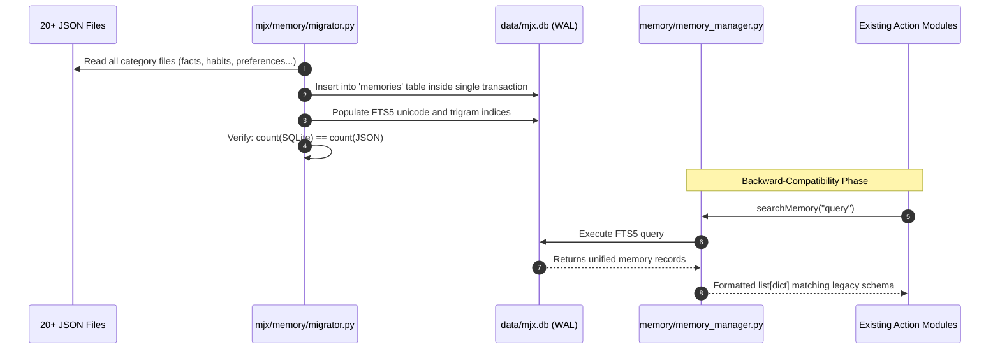

# MJ-X — ZERO-REGRESSION MIGRATION STRATEGY & TRANSITION PLAYBOOK
**Strategy Goal:** Seamless Evolution of Live Codebase Without Breaking Working Features  
**Risk Tolerance:** Zero Data Loss & Zero Downtime  
**Validation Standard:** Dual-Path Verification & Automated Parity Checks  

---

## 1. MIGRATION PHILOSOPHY & SAFETY INVARIANTS

The biggest danger in refactoring a 7,000-line monolithic codebase ([main.py](file:///home/obito/Documents/MJ-X/main.py) + [ui.py](file:///home/obito/Documents/MJ-X/ui.py)) is the **"Big Bang" rewrite trap**, where everything is rewritten simultaneously and nothing compiles.

MJ-X will follow an **Incremental Strangler Fig Pattern**:
1. **Never touch working code without a failing test first.**
2. **Never delete legacy files until the replacement passes automated parity tests.**
3. **Keep legacy interfaces alive using adapters during the transition.**


---

## 2. DETAILED MIGRATION PHASES

### STEP 1: PRE-MIGRATION SAFETY CHECKPOINT & BASELINE TEST
Before a single line of code is edited:
1. **Git Tagging:** Create an annotated git tag: `git tag -a v0.5.0-pre-migration -m "Working baseline before modular architecture migration"`.
2. **Offline Data Snapshot:** Create an uncompressed archive of all current configuration and memory files:
   `tar -czf pre_migration_backup.tar.gz config/ memory/ android/bin/`.
3. **Automated Smoke Test Verification:** Execute an automated script verifying:
   - Python 3.11/3.14 import sanity.
   - `PyQt6` initializes without `DISPLAY` crashes.
   - `sounddevice` enumerates available host audio devices.
   - Record current baseline memory consumption in idle state.

---

### STEP 2: CREDENTIAL VAULT MIGRATION (ZERO-SECRET-LOSS)
1. **Vault Engine Implementation:** Create `mjx/security/vault.py` wrapping the `keyring` library.
2. **Non-Destructive Read:** Read `gemini_api_key` from [config/api_keys.json](file:///home/obito/Documents/MJ-X/config/api_keys.json).
3. **Vault Insertion & Test Retrieval:**
   ```python
   # 1. Store in OS Vault
   vault.set_key("gemini_api_key", existing_key)
   # 2. Immediately read back and verify
   retrieved = vault.get_key("gemini_api_key")
   if retrieved != existing_key:
       raise RuntimeError("Keyring verification failed! Aborting migration.")
   ```
4. **Sanitize Active Config:** Only after verified retrieval, replace the raw key in `config/api_keys.json` with an empty string or `"USE_OS_VAULT"`.
5. **Rollback Mechanism:** If `keyring` raises `KeyringLocked` or backend errors, the vault falls back to an encrypted local file (`config/vault.bin`) with user-provided passphrase; it never crashes the application.

---

### STEP 3: DUAL-PATH MEMORY MIGRATION (SQLITE + FTS5)
To transition from 20+ scattered JSON files to a unified SQLite database without breaking active tools:



1. **Schema Initialization:** Apply `schema_migrations/001_initial_schema.sql` creating `conversations`, `messages`, `memories`, and `memories_fts`.
2. **Batch Import:** A dedicated migration script (`mjx/memory/migrator.py`) parses all existing JSON files in `memory/`:
   - `facts.json`, `preferences.json`, `habits.json`, `work.json`, etc.
   - Generates normalized `fold` fields and calculates initial importance scores.
   - Inserts all records inside a single SQLite transaction (`BEGIN TRANSACTION ... COMMIT;`).
3. **Parity Verification:** The script runs 20 deterministic search queries across both the legacy inverted index and the new SQLite FTS5 table, comparing recall results.
4. **Adapter Redirection:** Update [memory/memory_manager.py](file:///home/obito/Documents/MJ-X/memory/memory_manager.py) so that `loadMemory()`, `saveMemory()`, `searchMemory()`, and `deleteMemory()` internally query `data/mjx.db`.
5. **Archival:** Move the legacy `.json` files to `memory/legacy_archive/` only after 7 days of verified error-free operation.

---

### STEP 4: SUBPROCESS SANITIZATION & PATCH REMOVAL
1. **Create Process Utility:** Implement `mjx/platform/process.py` providing `run_silent()` and `popen_silent()`.
2. **Update Action Modules:** Update calls in [actions/open_app.py](file:///home/obito/Documents/MJ-X/actions/open_app.py), [actions/system_optimizer.py](file:///home/obito/Documents/MJ-X/actions/system_optimizer.py), etc., to use `run_silent()`.
3. **Remove Global Monkey-Patch:** Delete lines 6–16 in [main.py](file:///home/obito/Documents/MJ-X/main.py) cleanly.
4. **Test:** Run all tools on Windows and verify that zero command prompt windows flash during tool execution.

---

### STEP 5: AUDIO ENGINE & SILERO VAD EXTRACTION
1. **Decouple Audio Loop:** Extract `_listen_audio()`, `_send_realtime()`, and `_receive_audio()` from `main.py` into `mjx/audio/engine.py`.
2. **Feature-Flagged VAD Gate:** Implement `SileroVADGatedStream` behind a configuration toggle (`vad_enabled: true/false`).
3. **A/B Benchmark:** Measure network packet rate and CPU utilization with VAD enabled vs. disabled. Confirm that VAD eliminates ~90% of idle packets while preserving the first syllable via the 1.0s pre-roll buffer.

---

## 3. ROLLBACK PROCEDURES & CONTINGENCY PLAYBOOK

| Failure Scenario | Automatic Trigger | Rollback Action | Recovery Time |
| :--- | :--- | :--- | :--- |
| **Keyring Failure on Startup** | `KeyringError` or missing backend | Re-read fallback configuration or prompt for master passphrase; never wipe keys. | < 2 seconds |
| **SQLite Migration Data Mismatch** | Record count or checksum disparity > 0 | Abort transaction; rollback to reading legacy JSON files; write error log. | Immediate |
| **Audio Thread Deadlock / Underrun** | `sounddevice` buffer overflow callback | Bypass Silero VAD gate; fall back to direct raw audio queue. | < 100ms |
| **FTS5 Compilation Missing in Runtime** | `sqlite3.OperationalError: no such module: fts5` | Fall back to standard `LIKE %query%` SQL query with warning. | Immediate |
