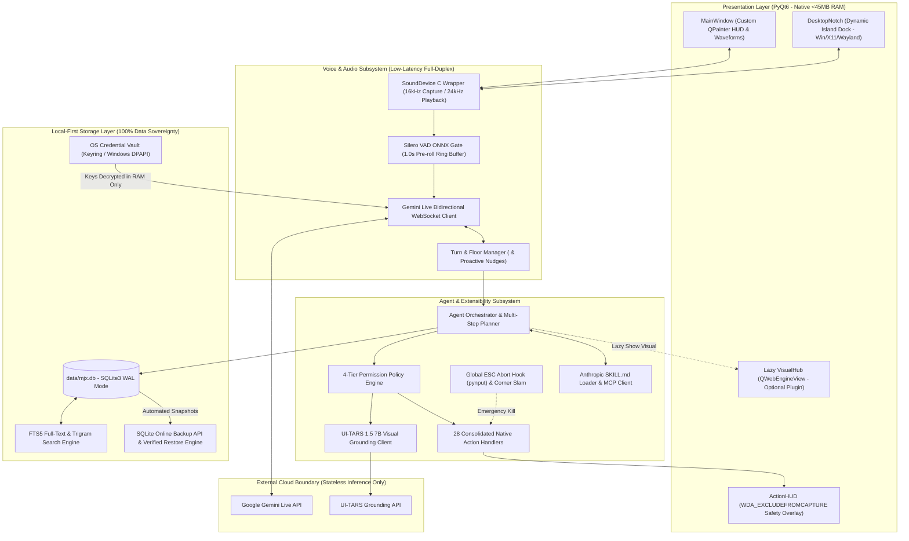

# MJ-X — FINAL APPROVED ARCHITECTURE SPECIFICATION
**Architecture Status:** **APPROVED WITH CORRECTIONS**  
**Target Environment:** Python 3.11+ / PyQt6 / Linux & Windows / Lenovo ThinkPad T420 (Sandy Bridge)  
**Data Paradigm:** 100% Local-First Canonical Storage / Cloud-Assisted Stateless Inference  
**Validation Decision:** **APPROVED WITH CORRECTIONS**  

---

## 1. OFFICIAL ARCHITECTURE DECISION & JUSTIFICATION

### FINAL DECISION: **APPROVED WITH CORRECTIONS**

### Evidence-Based Justification:
The baseline architecture laid out in `MJX_MASTER_ARCHITECTURE.md` is **fundamentally sound and approved**. It correctly chooses a **modular monolith** approach over risky process separation or Electron rewrites, preserves the high-performing native PyQt6 presentation engine (<45MB RAM), and enforces strict local-first data sovereignty.

However, full approval is granted subject to **six mandatory technical corrections** validated against the existing codebase and hardware constraints:

1. **Correction 1 (Hinglish Search):** Replaced naive consonant-skeleton stripping with SQLite FTS5 Unicode61 + Trigram indexing and query-time synonym expansions, preventing catastrophic semantic collisions in Indo-Aryan words (e.g. `pata`/`pita`/`poti`).
2. **Correction 2 (RAM Conservation on T420):** Reclassified the Chromium-based `VisualHub` (`QWebEngineView`) as a **strict lazy-loaded optional plugin**. It is never imported at boot, preserving the sub-120MB memory budget on 4GB systems.
3. **Correction 3 (Subprocess Safety):** Mandated the creation of a centralized `safe_run()` process utility across all 28 action modules *before* deleting lines 6–16 in `main.py`, preventing flashing terminal windows on Windows.
4. **Correction 4 (Platform Adaptability):** Added explicit runtime display server detection (`Wayland` vs `X11` vs `Win32`) for the Desktop Presence notch, gracefully degrading to a floating tool window on Wayland compositors that forbid arbitrary input-masking.
5. **Correction 5 (Zero-Breakage Memory Transition):** Mandated a backward-compatible adapter in `memory/memory_manager.py` routing legacy `loadMemory()` / `searchMemory()` calls to the new SQLite database so existing action scripts do not break.
6. **Correction 6 (Lockless Audio Loop):** Mandated that the `sounddevice` C callback remains completely lockless, delegating buffer dispatching to the asyncio loop via thread-safe queues.

---

## 2. COMPLETE TARGET SYSTEM ARCHITECTURE

---

## 3. FINAL MODULE CONTRACTS & SPECIFICATIONS

### 3.1. Voice & Audio Engine (`mjx.audio`)
- **Microphone Ingestion:** `sounddevice.InputStream` sampling at 16,000 Hz, 16-bit mono.
- **VAD Processing:** `silero_vad.onnx` executed via `onnxruntime` (<8MB RAM, <0.8% CPU on i5-2520M).
- **Buffering Policy:**
  - `preroll_buffer`: Circular `collections.deque` holding 1.0s (32,000 bytes).
  - `hangover_duration`: 0.8 seconds of sustained silence required before closing speech window.
  - `keep_alive_ping`: Transmits a 0.1s silence packet every 10s during prolonged quiet periods to keep WebSocket alive.
- **Audio Output:** `sounddevice.OutputStream` at 24,000 Hz. Audio chunks split into ~50ms slices (2,400 bytes) to enable instantaneous interruption within 50ms upon user barge-in.

### 3.2. Local-First Memory Service (`mjx.memory`)
- **Canonical Storage:** Single SQLite database at `data/mjx.db` running in WAL mode with a 5000ms busy timeout.
- **Search Capabilities:** SQLite FTS5 using `unicode61 remove_diacritics 2` for whole-word indexing and `trigram` for typo and partial-string matching.
- **Backup & Recovery Protocol:**
  - Automated versioned snapshots using `sqlite3.Connection.backup()`.
  - Integrity verified on every backup via `PRAGMA integrity_check == 'ok'`.
  - Atomic restore via temporary candidate swap with automatic pre-restore rollback copy.
- **Legacy Compatibility:** `memory/memory_manager.py` acts as a facade, converting legacy calls (`loadMemory`, `saveMemory`, `searchMemory`) to SQL queries without breaking external tools.

### 3.3. Computer Use & Visual Grounding (`mjx.agent`)
- **Screen Ingestion:** `mss` captures multi-monitor frames in <15ms; scaled to max dimension 1920x1080 at JPEG quality 85.
- **Visual Grounding:** Calls `bytedance/ui-tars-1.5-7b` endpoint, returning normalized `(x, y)` coordinates mapped back to actual screen geometry.
- **Safety Interruption:**
  - `ActionHUD` overlay set with Win32 `SetWindowDisplayAffinity(WDA_EXCLUDEFROMCAPTURE)` so the agent never clicks its own buttons.
  - Global `pynput` listener halts any active automation loop within 50ms upon user pressing `ESC`.
  - PyAutoGUI corner slam (`x=0, y=0`) failsafe enabled by default.
- **4-Tier Permission Policy:**
  - *Tier 1 (Read-Only):* System metrics, screenshots, active window inspect (Auto-approved).
  - *Tier 2 (Interactive):* Clicking links, switching windows, typing in search bars (Notified on HUD).
  - *Tier 3 (Consequential):* Sending WhatsApp messages, creating files, modifying settings (Modal confirmation required).
  - *Tier 4 (High Impact):* File deletion, executing terminal scripts, installing packages (Explicit confirmation + rollback requirement).

### 3.4. Desktop Presence Notch (`mjx.ui.notch`)
- **Form Factor:** Compact 380x36px pill docked at top-center of screen.
- **States:**
  - *Minimal:* Displays active status dot and micro audio waveform.
  - *Expanded (Hover/Voice):* Animates downward to reveal live transcription, avatar badge, and mute/stop controls.
- **Platform Handling:**
  - Windows & Linux X11: Borderless layered window with `WA_TransparentForMouseEvents` on outer frame.
  - Linux Wayland: Borderless floating tool window without click-through masking, positioning safely within compositor boundaries.

### 3.5. Security & Credential Vault (`mjx.security`)
- **OS Keyring Integration:** Interfaces with Windows DPAPI via Credential Manager and Linux SecretService via D-Bus.
- **Zero Plaintext Rule:** Plaintext keys are permanently purged from `config/api_keys.json`.
- **Local Fallback:** If OS Keyring is unavailable or locked, prompts user for master passphrase to initialize AES-256-GCM encrypted vault file (`config/vault.bin`).

---

## 4. IMMEDIATE FIRST ACTIONABLE IMPLEMENTATION TASK

With the architecture validated and approved with corrections, the exact first task for the subsequent implementation sprint is:

> **Phase P0 — Step 1: Credential Vault Migration & Subprocess Sanitization**
> 1. Implement `mjx/security/vault.py` using `keyring`. Read existing `gemini_api_key` from `config/api_keys.json`, store it in the OS vault, verify retrieval, and sanitize the disk file.
> 2. Create `mjx/platform/process.py` providing `safe_run()`. Refactor tool calls across `actions/` to use `safe_run()`, and then safely remove the global `subprocess.Popen` monkey-patch in `main.py:6–16`.
> 3. Verify that the application boots cleanly on both Linux and Windows with zero console windows flashing.
