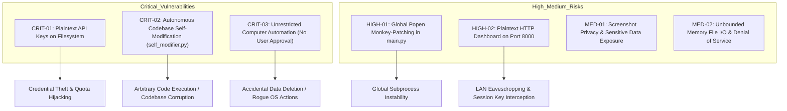

# MJ-X — COMPREHENSIVE SECURITY & RISK AUDIT
**Repository:** `/home/obito/Documents/MJ-X`  
**Auditor:** Senior Security Engineer & System Architect  
**Audit Standard:** OWASP Top 10, CWE / SANS Top 25, Local Desktop Agent Threat Model  

---

## 1. EXECUTIVE SECURITY SUMMARY

The security posture of MJ-X currently exhibits significant vulnerabilities common in early-stage autonomous desktop agent prototypes. Because the assistant possesses local OS automation privileges (mouse control, keyboard typing, process execution, file deletion, and codebase self-modification), any flaw in input sanitization, permission validation, or credential storage represents a high-severity risk to the host system.



---

## 2. DETAILED VULNERABILITY FINDINGS

### CRIT-01: Plaintext API Key & Token Storage
- **Location:** [config/api_keys.json](file:///home/obito/Documents/MJ-X/config/api_keys.json)
- **CWE:** CWE-312 (Cleartext Storage of Sensitive Information)
- **Severity:** **CRITICAL**
- **Evidence:**
  ```json
  {
      "gemini_api_key": "AIzaSy...",
      "os_system": "linux"
  }
  ```
- **Risk:** Any background application, non-privileged script, or malicious package running under the user session can read `api_keys.json` in plaintext and exfiltrate the user's Google Gemini API key.
- **Remediation:** Migrate immediately to an OS-level credential vault:
  - Windows: Windows DPAPI (`CryptProtectData` via `ctypes` or `pywin32`).
  - Linux: SecretService / FreeDesktop Secret API via Python `keyring` package.
  - Fallback: AES-256-GCM encryption with a machine-bound hardware fingerprint key.

---

### CRIT-02: Unchecked Codebase Self-Modification (`self_modifier.py`)
- **Location:** [core/self_modifier.py](file:///home/obito/Documents/MJ-X/core/self_modifier.py), [core/neural_brain.py](file:///home/obito/Documents/MJ-X/core/neural_brain.py)
- **CWE:** CWE-94 (Improper Control of Generation of Code / Code Injection)
- **Severity:** **CRITICAL**
- **Evidence:**
  `self_modifier.py` allows the LLM to rewrite Python files in the live MJ-X repository based on execution feedback. Code safety is checked solely by a tiny 3-layer NumPy MLP (`neural_brain.py`) trained on 10 arbitrary AST features.
- **Risk:**
  1. A hallucinated or adversarial prompt injection can rewrite `main.py` or `actions/` to insert destructive logic.
  2. The custom neural network has zero formal verification guarantees; it cannot detect subtle syntax errors, infinite loops, or malicious shell payloads.
  3. A bad edit will permanently break the assistant, requiring manual git intervention.
- **Remediation:**
  - **Disable runtime self-modification of core engine files.**
  - Code improvements must be generated as isolated diffs/patches in a `sandbox/` directory requiring explicit user review and testing before merging.

---

### CRIT-03: Unrestricted Computer Automation Without Permission Gates
- **Location:** [actions/computer_control.py](file:///home/obito/Documents/MJ-X/actions/computer_control.py), [actions/autopilot.py](file:///home/obito/Documents/MJ-X/actions/autopilot.py)
- **CWE:** CWE-862 (Missing Authorization)
- **Severity:** **HIGH**
- **Evidence:**
  `computer_control` executes mouse clicks, text typing, window switching, and keyboard shortcuts directly upon model invocation without:
  1. Presenting a visual confirmation dialog to the user.
  2. Differentiating between benign actions (scrolling) and destructive actions (closing windows, deleting files, clicking "Submit" or "Buy").
  3. Having a global ESC emergency brake.
- **Remediation:**
  - Implement a **3-Tier Permission Boundary**:
    - *Tier 1 (Read-Only / Benign):* Scrolling, moving cursor, taking screenshots (Auto-approved).
    - *Tier 2 (Interactive):* Clicking links, switching windows, typing in search bars (Requires visual notification).
    - *Tier 3 (Sensitive / Destructive):* Deleting files, modifying system settings, sending messages, running terminal scripts (Requires explicit modal confirmation with timeout).
  - Implement a global keyboard hook (`pynput` / Win32 `SetWindowsHookEx`) listening for `ESC` to abort automation within 50ms.

---

### HIGH-01: Global Subprocess Monkey-Patching in `main.py`
- **Location:** [main.py](file:///home/obito/Documents/MJ-X/main.py#L6-L16)
- **CWE:** CWE-695 (Use of Low-Level Functionality)
- **Severity:** **HIGH**
- **Evidence:**
  ```python
  if _platform.system() == "Windows":
      _OrigPopen = _subprocess.Popen
      class _Popen(_OrigPopen):
          def __init__(self, args, **kw):
              kw["creationflags"] = kw.get("creationflags", 0) | _subprocess.CREATE_NO_WINDOW
              kw.pop("startupinfo", None)
              super().__init__(args, **kw)
      _subprocess.Popen = _Popen
  ```
- **Risk:** Monkey-patching Python's standard library `subprocess.Popen` at runtime alters the behavior of *all* third-party libraries imported in the process (e.g., `playwright`, `sounddevice`, `multiprocessing`). This breaks libraries that depend on standard handles, child process pipes, or console window creation.
- **Remediation:** Remove the global monkey-patch. Pass explicit execution flags (`creationflags=_subprocess.CREATE_NO_WINDOW`) only within MJ-X's own helper functions.

---

### HIGH-02: Plaintext HTTP Remote Dashboard on Local Network
- **Location:** [dashboard/server.py](file:///home/obito/Documents/MJ-X/dashboard/server.py#L4)
- **CWE:** CWE-319 (Cleartext Transmission of Sensitive Information)
- **Severity:** **HIGH**
- **Evidence:**
  `dashboard/server.py` binds FastAPI to port 8000 using standard HTTP. While it attempts to implement application-layer encryption (AES-256-CBC with `session_key`), the initial pairing and key exchange occur over an unencrypted channel.
- **Risk:** Anyone on the same local Wi-Fi network (home, office, public café) can capture HTTP traffic, extract session tokens, and interact with the MJ-X control plane.
- **Remediation:**
  - Enforce TLS (HTTPS / WSS) with a locally generated self-signed certificate.
  - Bind to `127.0.0.1` by default; only allow external network binding when explicitly enabled with QR code token validation.

---

### MED-01: Screenshot Privacy & Sensitive Data Leakage
- **Location:** [actions/screen_processor.py](file:///home/obito/Documents/MJ-X/actions/screen_processor.py), [actions/computer_control.py:325](file:///home/obito/Documents/MJ-X/actions/computer_control.py#L325)
- **CWE:** CWE-359 (Exposure of Private Personal Information)
- **Severity:** **MEDIUM**
- **Evidence:**
  Full-desktop screenshots are captured and transmitted uncompressed to the Google Gemini API whenever `screen_process` or `_screen_find` is invoked.
- **Risk:** If the user has bank accounts, passwords, private WhatsApp chats, or medical records visible on screen, those sensitive pixels are sent directly to cloud inference APIs. Furthermore, MJ-X captures its own UI window, resulting in visual recursion.
- **Remediation:**
  - Apply Win32 `SetWindowDisplayAffinity(WDA_EXCLUDEFROMCAPTURE)` to the MJ-X window so it is never included in screen captures.
  - Provide a UI toggle for "Screenshot Privacy Shield" allowing users to define exclusion regions or restrict captures to a specific selected window.
