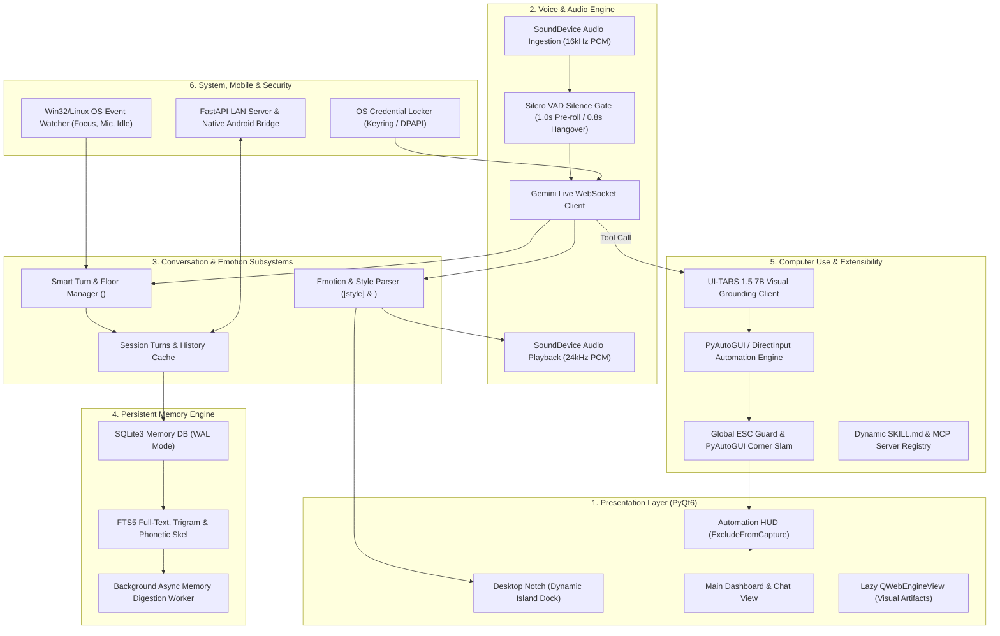

# MJ-X — NEXT-GENERATION PROPOSED MODULAR ARCHITECTURE
**Target Framework:** Python 3.11+ / PyQt6 / Google Gemini Live API  
**Architectural Goal:** Ultra-Lightweight (<120MB RAM), High-Performance, Privacy-First Autonomous Desktop Agent  

---

## 1. HIGH-LEVEL ARCHITECTURE OVERVIEW

The next-generation MJ-X architecture discards monolithic spaghetti code in favor of **11 decoupled, single-responsibility subsystems**. Communication between asynchronous background engines and the PyQt6 GUI is orchestrated cleanly using Qt's thread-safe Signal/Slot mechanism (`pyqtSignal`) and standard Python `asyncio.Queue` pipelines.



---

## 2. DETAILED MODULE SPECIFICATIONS

### Module 1: Presentation Layer (`mjx/ui/`)
- **Responsibilities:** Renders the desktop presence notch, full chat dashboard, automation HUD, and lazy-loaded visual artifacts.
- **Components:**
  - `DesktopNotch`: Borderless, transparent widget pinned to the top-center screen edge. Supports hover expansion and mouse event pass-through via `Qt.WidgetAttribute.WA_TransparentForMouseEvents`.
  - `MainWindow`: Primary 980x700 dashboard housing the custom QPainter audio visualizer, chat log, and settings.
  - `ActionHUD`: Floating action indicator displaying the agent's current thought and active click target. Configured with Win32 `SetWindowDisplayAffinity(WDA_EXCLUDEFROMCAPTURE)` to prevent self-capture.
  - `VisualHub`: An isolated `QWebEngineView` instantiated on-demand when `show_visual` is invoked.
- **Dependencies:** `PyQt6` (core, gui, widgets, optional webengine).

---

### Module 2: Voice & Audio Engine (`mjx/audio/`)
- **Responsibilities:** Captures microphone frames, applies local VAD gating, communicates with Gemini Live, and plays back responses.
- **Internal Interfaces:**
  ```python
  class AudioEngine:
      async def start(self) -> None: ...
      async def send_audio(self, pcm_bytes: bytes) -> None: ...
      def mute(self, is_muted: bool) -> None: ...
  ```
- **Silero VAD Gating Architecture:**
  - Maintains a circular ring buffer storing 1.0 second of 16kHz PCM audio (`16,000 samples = 32,000 bytes`).
  - Evaluates speech probability using `silero-vad` via ONNX Runtime (< 8MB RAM).
  - When speech probability exceeds `0.5`, flushes the 1.0s pre-roll buffer to Gemini Live and streams active frames.
  - When speech drops below threshold for > 0.8 seconds (hangover), halts transmission and transmits the end-of-turn signal.
- **Dependencies:** `sounddevice`, `numpy`, `onnxruntime`.

---

### Module 3: Emotion & Personality Engine (`mjx/emotion/`)
- **Responsibilities:** Manages conversational style and directs realistic vocal performance in Gemini Live.
- **Model-Supported Performance Formatting:**
  Instead of multiplying PCM volumes, the prompt directs Gemini Live to format its responses with performance cues:
  - *Style Directions:* `[soft and slow]`, `[warm, delighted]`, `[urgent, quick]`, `[gentle whisper]`.
  - *Audio Tags:* `[sigh]`, `[chuckle]`, `[laughs]`, `[gasp]`, `[throat-clearing]`.
  - *TTS Chunking:* The first short sentence is isolated for instant delivery (~750ms TTFA), while subsequent paragraphs stream continuously.
- **Dependencies:** Standard library regex and text parsing.

---

### Module 4: Conversation Context & Floor Manager (`mjx/conversation/`)
- **Responsibilities:** Manages conversation history, turn-taking boundaries, aside detection, and proactive nudges.
- **Floor Heuristics (`<quiet:aside>`):**
  - Continuous listening recognizes ambient conversation not addressed to the assistant (e.g. side conversations, phone calls).
  - If speech lacks direct intent, the engine discards the turn cleanly.
  - *Proactive Nudge Timer:* If the assistant asked a question and silence ensues, fires an 8-second gentle nudge ("Still there?"), followed by a final 20-second reminder.

---

### Module 5: Persistent Memory Engine (`mjx/memory/`)
- **Responsibilities:** SQLite-based long-term fact storage, verbatim turn retention, and semantic retrieval.
- **Database Schema (`memory.db`):**
  ```sql
  PRAGMA journal_mode = WAL;
  
  CREATE TABLE turns (
      id INTEGER PRIMARY KEY AUTOINCREMENT,
      session_id TEXT NOT NULL,
      role TEXT NOT NULL,
      text TEXT NOT NULL,
      timestamp REAL NOT NULL
  );

  CREATE TABLE memories (
      id INTEGER PRIMARY KEY AUTOINCREMENT,
      category TEXT NOT NULL,
      fact TEXT NOT NULL,
      fold TEXT NOT NULL,
      skel TEXT NOT NULL,
      importance INTEGER DEFAULT 5,
      created_at REAL NOT NULL
  );

  CREATE VIRTUAL TABLE memories_uni USING fts5(
      fold, content='memories', content_rowid='id', tokenize='unicode61'
  );

  CREATE VIRTUAL TABLE memories_tri USING fts5(
      fold, content='memories', content_rowid='id', tokenize='trigram'
  );

  CREATE VIRTUAL TABLE memories_skel USING fts5(
      skel, content='memories', content_rowid='id', tokenize='unicode61'
  );
  ```
- **Phonetic Skeleton Normalization:** Normalizes Roman Urdu/Hindi variations (e.g., "mujhe jana hai" -> `mjh jn h`), matching phonetically across both Latin and Devanagari scripts.

---

### Module 6: Multimodal Perception Engine (`mjx/vision/`)
- **Responsibilities:** Captures screen and webcam inputs with minimal CPU and memory overhead.
- **Specifications:**
  - `mss` captures primary or multi-monitor screens in < 15ms.
  - Downscales images to max dimension 1920x1080 at JPEG quality 85% to minimize API upload payloads.
- **Dependencies:** `mss`, `Pillow`, `opencv-python`.

---

### Module 7: Computer Use Agent (`mjx/agent/`)
- **Responsibilities:** High-precision GUI automation with visual grounding and emergency safety gates.
- **Visual Grounding Pipeline:**
  1. Capture screen via `mss` (excluding HUD via display affinity).
  2. Dispatch image to `bytedance/ui-tars-1.5-7b` grounding endpoint to predict accurate `(x, y)` target coordinates.
  3. Verify action safety against the 3-tier permission matrix.
  4. Execute action via `pyautogui`.
- **Safety Interruption:**
  - Global `ESC` listener using `pynput` kills the active action loop within 50ms.
  - Corner slam (moving mouse to `(0, 0)`) immediately trips PyAutoGUI failsafe.

---

### Module 8: Skills & MCP Integration (`mjx/skills/`)
- **Responsibilities:** Extensibility engine supporting Anthropic `SKILL.md` format and Model Context Protocol.
- **Folder Contract:** `~/.mjx/skills/<skill-name>/SKILL.md`.
- **Registration:** Reads YAML frontmatter (`name`, `description`, `when_to_use`) and injects dynamic tool declarations into the Gemini Live session.

---

### Module 9: Desktop Presence & OS Sensory Awareness (`mjx/system/`)
- **Responsibilities:** Monitors local OS events with zero cloud cost.
- **Sensory Probes:**
  - Windows: Query `GetForegroundWindow`, check if Zoom / Teams / Meet is consuming the microphone.
  - Linux: Query `xdotool` / `wmctrl` or D-Bus for active window status.
  - Inhibit speech automatically when a full-screen video, presentation, or meeting is detected.

---

### Module 10: Mobile Companion API (`mjx/server/`)
- **Responsibilities:** LAN-accessible FastAPI server for Android companion and mobile PWA pairing.
- **Specifications:**
  - Binds to local IP with QR code token authentication.
  - Native Android app communicates via WebSocket to receive notifications and stream audio.

---

### Module 11: Security & Credential Vault (`mjx/security/`)
- **Responsibilities:** Encrypts API keys and enforces permission gates.
- **Storage:** Uses Python's `keyring` library to store keys in Windows DPAPI or Linux SecretService. Keys are never written to disk in plaintext.
