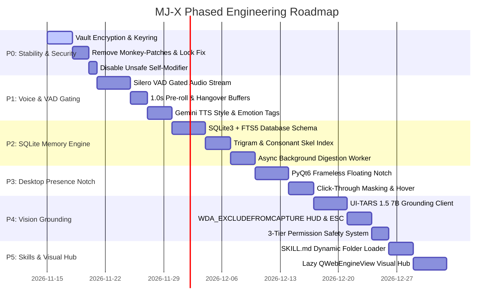

# MJ-X — PHASED IMPLEMENTATION ROADMAP & ENGINEERING SPRINT PLAN

This roadmap establishes a rigorous, phased engineering sequence to transform MJ-X into a next-generation assistant without destabilizing its existing working features.

---

## 1. IMPLEMENTATION PRIORITY TIMELINE

---

## 2. DETAILED SPRINT SPECIFICATIONS

### PHASE P0: EXISTING BUGS, SECURITY & STABILITY (CRITICAL FOUNDATION)
- **Objective:** Eliminate critical security vulnerabilities, remove standard library monkey-patches, and stabilize threading locks before building new features.
- **Files Affected:**
  - `config/api_keys.json`
  - `main.py` (lines 6–16, Popen patch removal)
  - `core/self_modifier.py`
- **New Files Required:**
  - `mjx/security/vault.py` (OS Keyring / Windows DPAPI wrapper)
  - `mjx/security/permissions.py` (Permission boundary checker)
- **Dependencies:** `keyring`, `cryptography`.
- **Implementation Steps:**
  1. Build `mjx/security/vault.py` utilizing Python's `keyring` library to store API keys in the Windows Credential Manager or Linux SecretService. Migrate keys from `api_keys.json` and sanitize the file on disk.
  2. Remove lines 6–16 in `main.py` which monkey-patch `subprocess.Popen`. Add explicit `creationflags=subprocess.CREATE_NO_WINDOW` only to internal action helper functions.
  3. Disable autonomous runtime code rewriting in `core/self_modifier.py`. Divert suggested code edits to a sandboxed review log.
  4. Fix race conditions between `self._speaking_lock` and `self.audio_in_queue` during barge-in interruptions.
- **Testing Strategy:** Verify subprocess execution across multiple background commands without hanging; verify API key persistence across system restarts.
- **Acceptance Criteria:** Zero plaintext API keys on disk; `subprocess.Popen` remains untouched in standard library; zero audio deadlock on interruption.
- **Potential Regressions:** Existing hardcoded tools that relied on unquoted command windows may need explicit creation flags.

---

### PHASE P1: VOICE ARCHITECTURE & CONVERSATIONAL INTELLIGENCE
- **Objective:** Drastically cut cloud token consumption, eliminate clipped speech, and enable expressive voice delivery.
- **Files Affected:**
  - `main.py` (`_listen_audio`, `_receive_audio`)
  - `emotion/voice.py`
  - `core/prompt.txt`
- **New Files Required:**
  - `mjx/audio/vad.py` (Silero VAD ONNX wrapper)
  - `mjx/audio/stream.py` (Gated audio stream with pre-roll circular buffer)
  - `mjx/conversation/floor.py` (Turn-taking and aside detection)
- **Dependencies:** `onnxruntime`, `numpy`, `sounddevice`.
- **Implementation Steps:**
  1. Implement `SileroVAD` using `onnxruntime` with `silero_vad.onnx` (< 8MB RAM).
  2. Implement `SileroVADGatedStream` with a 1.0s pre-roll ring buffer (16,000 samples) and 0.8s hangover buffer. Audio is only placed on `self.out_queue` when speech probability > 0.5.
  3. Update `core/prompt.txt` with performance instructions:
     - Direct the model to output bracketed delivery tags (`[warm]`, `[soft and slow]`, `[urgent]`) and inline sounds (`<sigh>`, `<chuckle>`, `<laughs>`).
     - Teach the model `<quiet:aside>` when user is conversing with someone else in the room.
  4. Parse the stream in `_receive_audio` to dispatch sentence-1 immediately (~750ms TTFA) while queuing the remainder.
- **Testing Strategy:** Speak with background YouTube music playing; confirm zero packets sent during music; confirm first syllable is crisp and unclipped.
- **Acceptance Criteria:** Cloud audio packet transmission drops to zero during silence; first-speech audio latency < 900ms; natural vocal inflections rendered.
- **Potential Regressions:** Users with very quiet microphones may need microphone sensitivity calibration.

---

### PHASE P2: PERSISTENT SQLITE MEMORY & HINGLISH PHONETICS
- **Objective:** Eliminate 20+ JSON files, stop disk thrashing, and provide instant bilingual memory recall.
- **Files Affected:**
  - `memory/` (all files)
  - `main.py` (memory tool bindings)
- **New Files Required:**
  - `mjx/memory/db.py` (SQLite connection manager with WAL mode)
  - `mjx/memory/schema.py` (FTS5 virtual tables and migrations)
  - `mjx/memory/phonetics.py` (Consonant-skeleton normalizer)
  - `mjx/memory/digest.py` (Background async turn summarizer)
- **Dependencies:** Standard library `sqlite3`.
- **Implementation Steps:**
  1. Create `memory.db` with WAL mode and tables: `sessions`, `turns`, `memories`.
  2. Build FTS5 indices: `memories_uni` (full word unicode), `memories_tri` (trigrams), and `memories_skel` (consonant-skeleton).
  3. Implement `consonant_skeleton()`: normalizes vowels and repeated letters across Hinglish, Urdu, and English (e.g. `jana` = `jaana` = `jn`).
  4. Implement an async migration script to transfer existing JSON facts into `memory.db`.
  5. Build background digestion task that reads raw `turns` every 10 turns and extracts lasting facts.
- **Testing Strategy:** Query memories using misspelled Roman Hindi ("mjhe jana h") and verify instantaneous match against "mujhe jaana hai".
- **Acceptance Criteria:** Zero individual category JSON files on disk; memory search takes < 3ms; full phonetic search verified.
- **Potential Regressions:** Legacy scripts expecting `long_term.json` must be re-routed through the new DB facade.

---

### PHASE P3: DESKTOP PRESENCE & DYNAMIC ISLAND NOTCH
- **Objective:** Provide a sleek, persistent floating presence docked at the top of the user's screen.
- **Files Affected:**
  - `ui.py`
  - `main.py` (window lifecycle signals)
- **New Files Required:**
  - `mjx/ui/notch.py` (Frameless click-through top-docked widget)
- **Dependencies:** `PyQt6`.
- **Implementation Steps:**
  1. Build `DesktopNotch(QWidget)` with `FramelessWindowHint | WindowStaysOnTopHint | Tool`.
  2. Dock widget flush to the top-center edge of the primary screen (`screen.geometry().width() / 2 - width / 2`).
  3. Default state: Minimal pill (width 380px, height 36px) showing assistant status dot and subtle audio waveform.
  4. Hover / Active Voice state: Smoothly animates downward to reveal live transcription, avatar badge, and mute control.
  5. Enable `Qt.WidgetAttribute.WA_TransparentForMouseEvents` on outer regions so desktop clicks pass through to background apps.
- **Testing Strategy:** Click on desktop shortcuts and browser tabs situated directly behind transparent areas of the notch; verify uninterrupted pass-through.
- **Acceptance Criteria:** Window sits flush at top of screen; CPU usage < 1% during animation; zero click interception on transparent regions.

---

### PHASE P4: VISION-GROUNDED COMPUTER USE & SAFETY GATES
- **Objective:** Replace inaccurate LLM coordinate guessing with a high-precision grounding model, protected by an action HUD and emergency ESC abort.
- **Files Affected:**
  - `actions/computer_control.py`
  - `actions/autopilot.py`
- **New Files Required:**
  - `mjx/agent/grounding.py` (UI-TARS 1.5 7B API client)
  - `mjx/agent/hud.py` (PyQt6 action overlay with display affinity exclusion)
  - `mjx/agent/safety.py` (Global ESC hook and 3-tier permission manager)
- **Dependencies:** `pynput`, `pyautogui`, `requests`.
- **Implementation Steps:**
  1. Replace `_screen_find` in `computer_control.py` with `UI-TARS 1.5 7B` endpoint (predicts exact pixel coordinates on screenshots scaled to max 1920x1080).
  2. Apply Win32 `SetWindowDisplayAffinity(hud_hwnd, 0x00000011)` (`WDA_EXCLUDEFROMCAPTURE`) so the HUD overlay is invisible to screenshot capture.
  3. Implement global ESC key listener via `pynput`: pressing ESC instantly aborts any running computer-use task within 50ms.
  4. Implement 3-tier permission gates: require a confirmation prompt before deleting files, sending messages, or modifying system configuration.
- **Testing Strategy:** Trigger an automated typing task and press ESC; verify execution halts immediately without leaving keys pressed.
- **Acceptance Criteria:** Coordinate prediction accuracy > 90% on small desktop icons; HUD never appears in vision screenshots; ESC terminates automation reliably.

---

### PHASE P5: DYNAMIC SKILLS & SANDBOXED VISUAL HUB
- **Objective:** Enable folder-based skill extensibility and interactive visual artifact presentation.
- **Files Affected:**
  - `main.py` (tool declaration registry)
- **New Files Required:**
  - `mjx/skills/loader.py` (Anthropic `SKILL.md` parser)
  - `mjx/ui/visual_hub.py` (Lazy-loaded sandboxed QWebEngineView)
- **Dependencies:** `PyQt6-WebEngine` (lazy-loaded).
- **Implementation Steps:**
  1. Build `SKILL.md` parser: scans `~/.mjx/skills/` for folders containing `SKILL.md` with YAML frontmatter.
  2. Dynamically register loaded skills into the Gemini Live tool definitions list.
  3. Build `VisualHub`: on demand, opens an isolated QWebEngineView window with local `file://` sandboxing and disabled remote networking to render interactive HTML/CSS diagrams generated by the assistant.
- **Testing Strategy:** Place a custom `SKILL.md` in the directory; confirm tool appears in the assistant's prompt and can be called.
- **Acceptance Criteria:** New tools can be added without modifying Python code; Visual Hub renders interactive charts with zero internet leakage.
