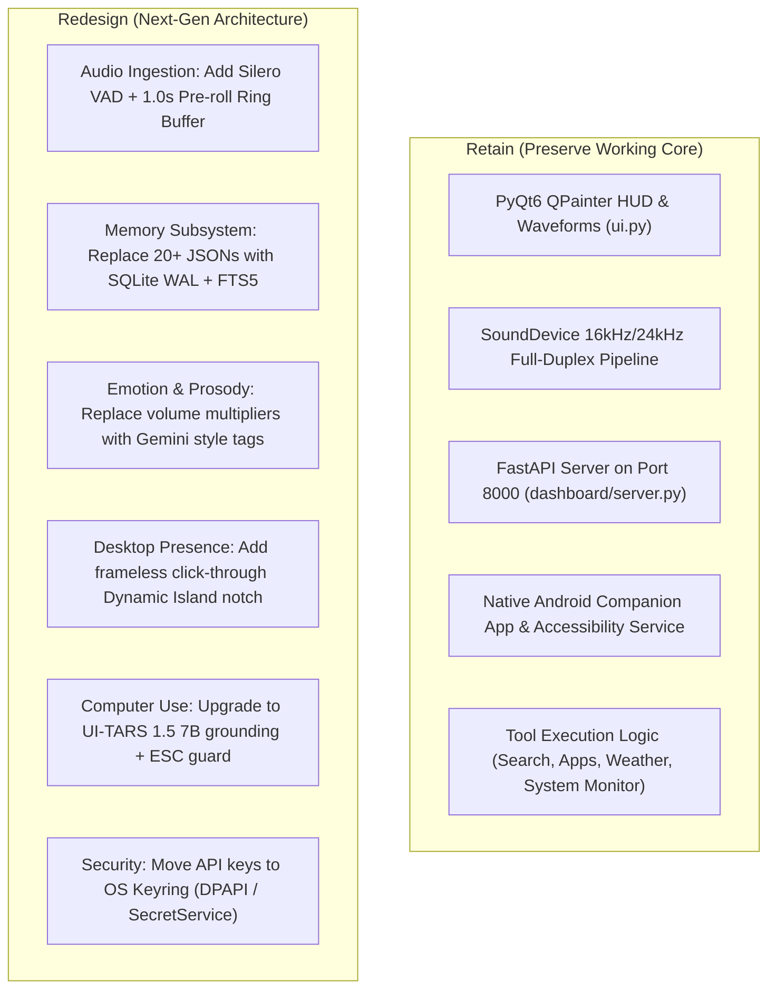

# MJ-X — FINAL ENGINEERING RECOMMENDATIONS & EXECUTIVE VERDICT
**Project Name:** MJ-X Autonomous Multimodal AI Desktop Assistant  
**Repository:** `/home/obito/Documents/MJ-X`  
**Evaluation Standard:** Independent Architecture Deconstruction & Empirical Codebase Audit  

---

## 1. ACTUAL CURRENT MATURITY OF MJ-X

MJ-X currently sits at an **Advanced Alpha Prototype (Maturity Level: 5.5 / 10)**.

- **What It Achieves:** It is not a mock or toy; it has an active, working bidirectional audio streaming pipeline connected to the Google Gemini Live API (`models/gemini-2.5-flash-native-audio-preview-12-2025`), a custom-painted PyQt6 HUD that renders at 60 FPS without web engine overhead, an extensive suite of 40+ local OS tools, and a dedicated native Android companion app.
- **Why It Is Not Production-Ready:** It is held back by architectural fragility: `main.py` (2,478 lines) and `ui.py` (4,150 lines) are monolithic; microphone audio is streamed unthrottled during silence, burning API quota; long-term memory is scattered across 20+ unindexed JSON files; API keys are stored in plaintext; and computer automation lacks visual coordinate grounding and emergency safety gates.

---

## 2. STRONGEST EXISTING COMPONENTS (DO NOT REWRITE)

These four subsystems represent exceptional engineering work and should be retained as the foundation of MJ-X:

1. **Custom QPainter HUD & Visual Identity (`ui.py`):**
   - Direct hardware-accelerated drawing (`QPainter`, `QConicalGradient`, `QPainterPath`) provides a distinctive, premium cybernetic aesthetic while consuming <45MB RAM. This is vastly superior to generic web wrappers.
2. **Native Full-Duplex Audio Pipeline (`main.py`):**
   - Real-time 16kHz audio ingestion via `sounddevice` and low-latency 24kHz PCM playback provide immediate conversational response times.
3. **Native Android Companion Project (`android/`):**
   - The native Java Android application with accessibility hooks and floating services (`MJFloatingService.java`) provides true mobile synergy that browser PWAs cannot match.
4. **Local FastAPI Remote Gateway (`dashboard/server.py`):**
   - A complete, self-contained server running on port 8000 with custom application-layer encryption, enabling local network telemetry and mobile interaction.

---

## 3. FIVE BIGGEST ENGINEERING WEAKNESSES

1. **Continuous Silence Streaming (Missing Local VAD Gating):**
   - In `main.py:1712–1718`, every frame of background room silence is continuously sent over TLS to Google, burning API quota and causing battery/fan load on older hardware like the ThinkPad T420.
2. **Plaintext Credential Storage (CWE-312):**
   - `config/api_keys.json` exposes the raw Google Gemini API key unencrypted on the filesystem.
3. **Disk-Thrashing Multi-JSON Storage:**
   - Long-term memory is fragmented across 20+ individual JSON files (`facts.json`, `preferences.json`, `habits.json`), repeatedly rewritten using atomic temp files, causing disk I/O bottlenecks and lacking phonetic search for Hinglish.
4. **Unsafe Monolithic Architecture & Monkey-Patching:**
   - `main.py` globally monkey-patches `subprocess.Popen` in Python's standard library, risking silent bugs in third-party libraries, while mixing audio streaming, UI signals, and 40+ tool definitions into a single file.
5. **Inaccurate Vision Automation & Lack of Safety Gates:**
   - `computer_control._screen_find` relies on general Gemini Flash for coordinate guessing (frequently missing buttons) and lacks a global ESC emergency abort or display affinity exclusion.

---

## 4. WHAT SHOULD BE RETAINED VS. REDESIGNED

---

## 5. EXACT FIRST IMPLEMENTATION TASK

When the user gives the instruction to begin development, **do NOT start with UI or voice features**. The absolute first implementation task must be establishing a secure, stable foundation:

### Task P0.1: Secure Credential Vault & Subprocess Sanitization
1. **Create `mjx/security/vault.py`:**
   - Implement secure key retrieval and storage using Python's `keyring` library (Windows DPAPI / Linux SecretService).
   - Read existing keys from `config/api_keys.json`, store them in the OS vault, and purge plaintext keys from disk.
2. **Sanitize `main.py` Standard Library Patching:**
   - Remove lines 6–16 in `main.py` that monkey-patch `subprocess.Popen`.
   - Ensure all internal action calls pass `creationflags=subprocess.CREATE_NO_WINDOW` explicitly through a safe helper function.
3. **Verification:**
   - Verify that MJ-X boots cleanly, loads its API key from the OS vault, and executes external shell actions without opening console windows or breaking third-party subprocess calls.
