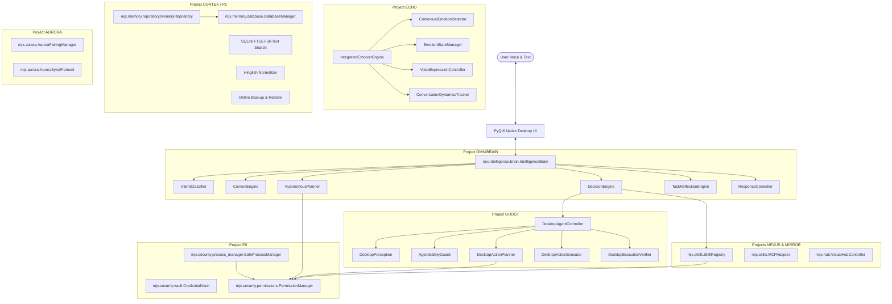

# MJ-X GENESIS FINAL REPORT — 03: MASTER ARCHITECTURE

**Subsystem:** Modular Intelligence & Unified System Topography  
**Architecture Paradigm:** Local-First Core, Cloud-Assisted Multimodal, Hardened Process Boundaries  

---

## 1. COMPONENT ARCHITECTURE DIAGRAM

---

## 2. SUBSYSTEM BOUNDARIES & INTERACTION CONTRACTS

1. **Client / Server Separation:**
   - PyQt6 UI and FastAPI Dashboard communicate strictly through service abstractions and data transfer objects (DTOs).
   - Zero direct database handles exposed to presentation layers.

2. **Security Mediation:**
   - Any operation interacting with the filesystem (`FILE_WRITE`), screen (`SCREEN_CAPTURE`), camera (`CAMERA_ACCESS`), or operating system input (`OS_INPUT_CONTROL`) must obtain a lease from `PermissionManager`.

3. **Deterministic Memory Pipeline:**
   - All conversations, turns, facts, and user configurations are committed through `MemoryRepository` using SQLite WAL mode transactions with immediate rollback on exception.
