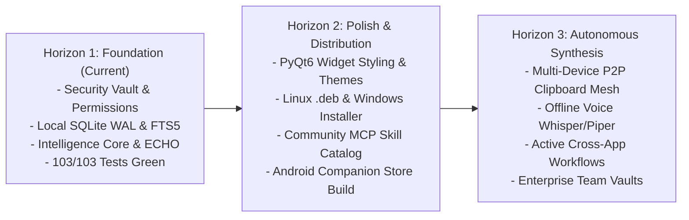

# MJ-X GENESIS FINAL REPORT — 16: STRATEGIC ROADMAP

**Subsystem:** Long-Term Product Evolution, Release Horizons & Ecosystem Roadmap  

---

## 1. RELEASE HORIZONS

---

## 2. PHASED ROLLOUT SCHEDULE

### Horizon 1: Core Foundation (COMPLETED)
- Full implementation and testing of Projects OMNIBRAIN, ECHO, CORTEX, GHOST, NEXUS, MIRROR, and AURORA.
- Complete regression verification ensuring existing 40+ tools and PyQt6 UI remain intact.

### Horizon 2: Polish & Packaging (Target: 30–60 Days)
- **Linux Packaging:** Build native `.deb` package with `systemd` user service integration.
- **Windows Packaging:** InnoSetup or MSIX packaging targeting Windows 10/11 with Credential Manager integration.
- **Visual Refinement:** Modernize PyQt6 UI styling following Obito's design guidelines (Royal Dark Navy `#001F3F` and `#0A192F` themes, zero generic AI slop).
- **Android Companion:** Release APK signed build with local QR-code PIN scanning.

### Horizon 3: Autonomous Ecosystem (Target: 90–180 Days)
- **Offline Fallback Engine:** Optional integration of Whisper.cpp and Piper TTS for voice assistance without active Internet connection.
- **Peer-to-Peer Multi-Device Mesh:** Synchronize encrypted memories between user's laptop, desktop, and phone without third-party cloud servers.
- **Enterprise Team Workspaces:** Multi-user shared vaults with role-based access control.
