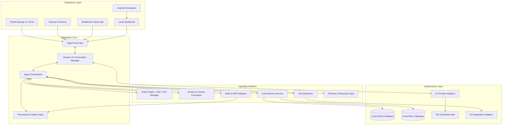

# MJ-X — MASTER ARCHITECTURE & ENGINEERING BLUEPRINT

**Document type:** Product and engineering architecture specification  
**Status:** Proposed baseline — requires source-level validation before implementation  
**Date:** 13 November 2026  
**Primary goal:** Evolve MJ-X into a modular, local-first, privacy-conscious multimodal AI ecosystem without discarding its working components.

---

## 0. Executive decision

MJ-X will evolve as a **local-first, cloud-assisted AI ecosystem**. The user's conversations, long-term memory, profile, settings, local files, and activity history remain on the user's devices by default. Cloud services may process requests for AI inference or explicitly authorized integrations, but cloud storage and cloud memory synchronization are not required for normal operation.

The project will be upgraded incrementally. It will not be rewritten from scratch, and Stonic AI will be treated as a capability benchmark rather than a source-code, product, or architecture blueprint.

This document is an architecture target, not proof that every proposed feature or API is currently available. Existing audit claims must be checked against the actual repository, installed dependency versions, official API documentation, and reproducible tests before implementation.

### Core principles

1. **Local-first data ownership:** Personal data is stored locally by default.
2. **Cloud-assisted intelligence:** Cloud inference is replaceable and must not own the user's canonical memory.
3. **Modular boundaries:** UI, audio, memory, agent execution, integrations, and transport are independently replaceable.
4. **Preserve working code:** Retain proven UI, audio, tools, dashboard, and Android components while extracting them behind stable interfaces.
5. **Permission before action:** The agent must not silently perform consequential actions.
6. **Secure by default:** Minimize exposed services, protect credentials, validate inputs, and maintain auditable actions.
7. **Low-spec aware:** Prefer asynchronous I/O, lazy loading, bounded queues, and cloud inference over heavyweight local models.
8. **Evidence over assumptions:** No unmeasured performance claims or unverified API features in release decisions.

---

## 1. Product vision

MJ-X is a personal AI ecosystem with a shared identity and controlled capabilities across desktop and mobile.

### 1.1 Intelligence layer

- **MJ Brain:** Intent understanding, task planning, tool selection, and response orchestration.
- **MJ Voice:** Real-time speech input/output, multilingual conversation, interruption handling, and turn management.
- **MJ Memory:** Local conversation history, user-approved long-term facts, retrieval, and memory lifecycle controls.
- **MJ Vision:** User-authorized screen, window, image, and camera understanding.
- **MJ Persona:** Consistent communication style and contextual response behavior. Emotion labels are internal hints, not claims about the user's actual mental state.

### 1.2 Execution layer

- **MJ Agent:** Permission-gated desktop and browser actions.
- **MJ Skills:** Extensible task capabilities with explicit schemas and permission declarations.
- **MJ Integrations:** MCP and other external services behind isolated adapters.
- **MJ Workflows:** Multi-step tasks with progress, cancellation, and verification.

### 1.3 Experience layer

- **MJ Desktop:** Native PyQt6 application and custom HUD.
- **MJ Presence:** Optional floating notch/compact presence surface.
- **MJ Hub:** Sandboxed visual workspace for generated artifacts.
- **MJ Mobile:** Native Android companion for approved remote interaction.
- **MJ Dashboard:** Local web interface for telemetry and selected controls.

These are product domains, not a mandate to create separate processes or services for every module. Keep the initial architecture as a modular monolith unless measurements or isolation requirements justify process separation.

---

## 2. Target system architecture



### 2.1 Architectural style

Use a **modular monolith** for the desktop application:

- One main application process initially.
- Clear Python package boundaries and dependency direction.
- Background work through bounded async tasks or worker threads where appropriate.
- No module should directly reach into another module's private state.
- Introduce a separate process only when there is a clear security, stability, or performance reason.

### 2.2 Dependency direction

- UI depends on application interfaces and typed events, not on database internals.
- Agent orchestration depends on capability interfaces, not concrete UI widgets.
- Memory owns its SQLite schema and migrations.
- Tool adapters own OS-specific execution details.
- Provider adapters own external AI SDK details.
- Security policy is called before any tool or integration executes.

Avoid circular imports and avoid a global singleton that becomes a second monolithic orchestrator.

---

## 3. Proposed repository structure

This is the target structure to migrate toward gradually. Do not move every file in one large refactor.

```text
MJ-X/
├── main.py                         # Thin application bootstrap
├── requirements/                   # Base and optional dependency sets
├── config/                          # Non-secret defaults only
├── mjx/
│   ├── app/                         # Lifecycle, settings, dependency wiring
│   ├── core/                        # Session manager, orchestrator, event contracts
│   ├── providers/                   # Gemini and future model adapters
│   ├── audio/                       # Device I/O, VAD, buffering, turn manager
│   ├── vision/                      # Screen/camera capture and perception
│   ├── memory/                      # SQLite repository, retrieval, migrations
│   ├── agent/                       # Planner, dispatcher, execution state
│   ├── security/                    # Vault, permissions, approvals, audit log
│   ├── tools/                       # Existing action wrappers/adapters
│   ├── skills/                      # Skill parser, registry, execution boundary
│   ├── integrations/                # MCP and external services
│   ├── ui/                          # Reusable PyQt6 widgets and windows
│   ├── dashboard/                   # FastAPI routes and WebSocket gateway
│   └── platform/                    # Linux/Windows-specific implementations
├── android/                         # Existing native Android project
├── data/                            # Runtime data root; never commit user data
├── backups/                         # Local backup destination, configurable
├── tests/
│   ├── unit/
│   ├── integration/
│   ├── security/
│   └── performance/
└── docs/
```

The existing `actions/`, `core/`, `emotion/`, `memory/`, `personality/`, and `dashboard/` directories can remain in place during the transition. Add adapters and migrate one subsystem at a time. Do not create duplicate implementations just to match this folder tree.

---

## 4. Local-first data architecture

### 4.1 Data ownership policy

| Data type | Canonical location | Cloud behavior |
|---|---|---|
| Conversation history | Local SQLite | Sent only when required for an AI request; not cloud-archived by MJ-X |
| Long-term memory | Local SQLite | Retrieved snippets may be sent for an explicitly requested AI task |
| User profile/preferences | Local SQLite | Not synchronized by default |
| App settings | Local config/database | No cloud sync by default |
| API credentials | OS credential vault | Never put in prompts, logs, or ordinary config files |
| Activity/security logs | Local SQLite or rotating local files | No automatic upload |
| User documents and generated files | User-selected local folders | Upload only after explicit user action or a clearly disclosed feature request |
| Skill definitions | Local skill folders | Skill content is not trusted code; execution requires policy checks |
| Backups | User-selected local destination | Optional encrypted cloud backup may be added later, disabled by default |

### 4.2 Database choice

Use SQLite as the canonical local store for structured application data. Enable WAL mode where supported and appropriate, configure a bounded busy timeout, and use transactions for multi-record changes.

Suggested initial database: `data/mjx.db`.

Suggested logical tables:

- `conversations`: conversation/session metadata.
- `messages`: user, assistant, and tool messages with timestamps and content type.
- `memories`: durable user-approved facts/preferences with source, confidence, created/updated timestamps, and lifecycle state.
- `memory_sources`: links a memory to the message/document from which it was derived.
- `attachments`: metadata and local file references; avoid storing large binaries directly unless justified.
- `tool_runs`: tool name, arguments summary, permission decision, result summary, and timestamps.
- `security_events`: approvals, denials, vault events, and safety stops.
- `settings`: non-secret preferences and feature configuration.
- `schema_migrations`: ordered migration history.

Do not store passwords, API keys, or other secrets in these tables.

### 4.3 Search and Hinglish support

Use SQLite FTS5 for full-text retrieval where available. Use a normal Unicode tokenizer baseline and evaluate the `trigram` tokenizer only after confirming it is supported by the SQLite build bundled with the target runtime.

For Hinglish retrieval:

- Preserve original text exactly.
- Normalize Unicode consistently for search fields without overwriting source text.
- Store optional normalized/transliterated variants as derived fields.
- Treat Roman Hindi, Devanagari Hindi, and English as related but distinct forms.
- Do not rely on a simple consonant-skeleton algorithm as the sole phonetic index; it can create false matches.
- Build a test corpus from real, consented sample queries and measure precision/recall before selecting a transliteration strategy.

If FTS5 external-content tables are used, implement and test insert/update/delete synchronization triggers. Include rebuild and integrity-check procedures.

### 4.4 Memory lifecycle

1. Save conversation messages locally.
2. A background digestion task may propose durable memories from selected conversations.
3. Mark each proposed memory with source provenance and confidence.
4. Apply user approval rules before promoting sensitive or uncertain information to long-term memory.
5. Deduplicate and update existing records rather than accumulating contradictory copies.
6. Provide controls to inspect, correct, export, and delete memories.
7. Deleting a memory must also handle its search index and derived records.

Do not silently infer sensitive traits or create high-impact profiles from casual conversation.

### 4.5 Backup and recovery

Local-first must include a real recovery plan.

- Create scheduled, versioned backups to a user-configured local folder or external drive.
- Use SQLite's online backup API or another SQLite-consistent backup method; do not copy only the main database file while WAL activity is ongoing.
- Encrypt backups when they contain personal data. Protect encryption keys separately from the backup file.
- Keep a configurable retention policy, such as a small set of daily and weekly restore points.
- Run periodic integrity checks and record results locally.
- Provide a restore workflow with a preview and explicit confirmation.
- Test restoration automatically in a temporary location; a backup that has never been restored is not proven.
- Never overwrite the only working database during restore. Restore to a new file, validate it, then perform a controlled swap with rollback capability.

Backups should be enabled by default only after the user selects or confirms a destination. Warn clearly if no backup destination is configured.

---

## 5. Security, permissions, and trust boundaries

### 5.1 Credential vault

Use the operating system's credential service through a maintained library such as `keyring`, but verify the selected backend at runtime.

- Linux: use a supported Secret Service backend; do not silently fall back to plaintext storage if the keyring is unavailable or locked.
- Windows: use Windows Credential Manager/DPAPI-backed storage where available.
- Provide a clear setup/recovery flow if no secure backend exists.
- Never log credential values or include them in exception dumps.
- Migrate existing plaintext credentials only after validating that the vault can store and retrieve them.
- Keep a restricted, user-controlled recovery path; do not automatically destroy the only copy of a key during migration.
- After successful migration, remove plaintext secrets from active config and ensure backups, logs, and version-control history are handled safely.

### 5.2 Tool permission tiers

Every tool declares a permission category and risk level.

| Tier | Examples | Default policy |
|---|---|---|
| Read-only | System status, read selected file, inspect active window | Allow only within declared scope; disclose capture/access state |
| Reversible low-impact | Open app, create draft note, navigate browser | Allow with clear user authorization and visible activity |
| Consequential | Send message, submit form, modify settings, move files | Require a just-in-time confirmation showing the exact action and target |
| Destructive/high-impact | Delete files, bulk changes, install software, execute elevated commands | Deny by default or require explicit, detailed confirmation and a safe recovery path |

The model's tool call is a request, not authorization. The policy engine makes the decision.

### 5.3 Computer-use safety

- Provide a global emergency stop and a visible stop control.
- Check cancellation between action steps and before each consequential action.
- Use bounded action timeouts and a maximum step count.
- Show the user what the agent intends to do before execution.
- Require confirmation for sending, deleting, purchasing, account changes, or system configuration changes.
- Verify the result after actions; report uncertainty instead of claiming success.
- Keep an audit record of the permission decision and outcome without storing unnecessary sensitive screen contents.
- Screen capture must be explicit, visible, and controllable. Do not promise universal capture exclusion; support differs by operating system and capture method.
- Never let an untrusted webpage, document, skill, or tool output override system policy or user permissions.

### 5.4 Self-modification and code execution

Autonomous self-modification is disabled by default. A model-generated code patch must never be applied directly to the live application without review.

If developer-assist code execution is retained:

- Run it in a restricted workspace with an allowlisted working directory.
- Do not expose unrestricted shell access as a normal assistant tool.
- Require confirmation for writes outside the workspace, package installation, network access, or destructive operations.
- Prefer diff previews and version-control checkpoints.
- Run tests before applying changes.
- Preserve a rollback path.

### 5.5 Dashboard and mobile gateway

- Bind to `127.0.0.1` by default.
- LAN access must be an explicit opt-in with a pairing flow and visible status indicator.
- Use short-lived, revocable pairing tokens; store only token hashes where practical.
- Apply authentication to every WebSocket and HTTP control route, not just the login page.
- Enforce origin checks, input validation, rate limits, and message-size limits.
- Use TLS for access beyond localhost; do not assume custom application-layer encryption alone is sufficient.
- Separate read-only telemetry from control permissions.
- Provide a one-click disconnect/revoke action.

### 5.6 Skills and MCP trust model

A `SKILL.md` file is descriptive metadata, not trusted executable code.

- Parse frontmatter with safe YAML loading.
- Validate a strict schema for skill name, description, inputs, outputs, and declared permissions.
- Do not execute arbitrary code embedded in skill files.
- Each skill calls approved capability interfaces through the policy engine.
- Treat tool outputs and remote MCP responses as untrusted data.
- Require user approval before enabling a new skill that can access files, network, accounts, or system controls.
- Keep skills disabled until validated and explicitly enabled.

---

## 6. Voice and audio architecture

### 6.1 Target pipeline


### 6.2 Requirements

- Preserve the current `sounddevice` full-duplex path while extracting it behind an `AudioEngine` interface.
- Add local VAD as an optional, benchmarked gate. It must have a bypass mode for debugging and accessibility cases.
- Use a bounded ring buffer to preserve the beginning of speech; the suggested one-second pre-roll and 0.8-second hangover are starting values, not immutable constants.
- Ensure audio callbacks do minimal work. Do not perform network requests, database access, or model inference inside the device callback.
- Use bounded queues and explicit overflow policies.
- Make interruption/cancellation flush or invalidate stale playback and network buffers safely.
- Add reconnect, timeout, and session rollover handling.
- Keep microphone state visible and provide an immediate mute control.
- Smart turn detection must be evaluated against natural pauses, Hinglish, noisy environments, and multiple speakers before becoming default.

### 6.3 Model/API capability rule

Do not assume text tags such as `[laughs]`, `<sigh>`, or `[softly]` cause expressive audio. Implement only features verified for the selected model and API version. Keep persona/style instructions separate from guaranteed speech-generation controls.

---

## 7. Memory and context architecture

The Memory Service exposes a stable interface:

- `save_message(...)`
- `search_conversation(...)`
- `propose_memory(...)`
- `approve_memory(...)`
- `update_memory(...)`
- `delete_memory(...)`
- `export_data(...)`
- `run_integrity_check(...)`

The agent should retrieve only the minimum relevant context needed for the current task. Memory retrieval must have source references so the assistant can distinguish remembered facts from current user instructions and model inference.

The system must support:

- Session context (current conversation).
- Episodic history (past conversations and events).
- User-approved semantic memory (stable preferences and facts).
- Project memory (per-project decisions, architecture, and progress).

Memory must never override an explicit current instruction. Conflicts should be surfaced and resolved rather than silently merged.

---

## 8. Agent orchestration and tool execution

### 8.1 Execution lifecycle

1. Receive user request.
2. Resolve intent and relevant context.
3. Produce a bounded plan when multi-step work is needed.
4. Select tools from the enabled registry.
5. Validate tool arguments against strict schemas.
6. Ask the permission engine for a decision.
7. Execute approved action with timeout/cancellation.
8. Verify the result.
9. Record a minimal local audit event.
10. Explain what succeeded, failed, or remains uncertain.

### 8.2 Tool contract

Every tool should declare:

- Stable tool identifier and version.
- Input/output schema.
- Permission tier and required scopes.
- Whether it reads, writes, sends, deletes, or executes.
- Timeout and cancellation behavior.
- Idempotency behavior where relevant.
- Result verification method.

Avoid registering arbitrary Python functions directly from model-generated content.

### 8.3 Existing tools

Retain the existing action implementations where they work, but route them through a single typed dispatcher and permission layer. Refactor gradually; do not rewrite all 40+ tool declarations in one pass.

---

## 9. Desktop UI, Presence, and Visual Hub

### 9.1 PyQt6 UI

Retain the existing QPainter visual identity and HUD. Refactor the monolithic UI into reusable widgets and controllers without changing the visual design in the first extraction pass.

### 9.2 Desktop Presence

Implement a compact, optional, frameless top-docked presence widget. Platform behavior must be implemented and tested separately for Linux and Windows. Click-through transparency is not assumed to work identically across platforms or window managers.

The widget must include:

- Visible microphone/listening state.
- Mute and stop controls.
- Clear active-task state.
- Keyboard-accessible controls and a way to open the full UI.
- No hidden capture or automation behavior.

### 9.3 Visual Hub

Visual Hub is an optional, lazy-loaded workspace for charts, diagrams, and interactive local artifacts.

- Use a restricted origin and a strict Content Security Policy.
- Disable unnecessary remote navigation, downloads, popups, and external resource loading.
- Expose no unrestricted Python bridge to rendered content.
- Validate generated artifact size and content type.
- Treat HTML/JavaScript as untrusted even when generated by the model.
- If secure isolation cannot be guaranteed by the selected web engine, use static rendering or a safer alternative.

---

## 10. Mobile and cross-device architecture

The Android companion remains a native project. It communicates with the desktop gateway only after explicit pairing.

Initial scope:

- Read-only status and connection health.
- Send a user message to the desktop assistant.
- Approve/deny a pending consequential action.
- Emergency stop and disconnect.

Later scope may include file transfer or remote desktop controls, each requiring separate permissions and clear user confirmation. Do not expose unrestricted desktop control from the phone by default.

Cross-device memory synchronization is not part of the initial release. If introduced later, it must be opt-in, end-to-end encrypted, conflict-aware, and independently revocable per device.

---

## 11. Performance and low-spec hardware strategy

The architecture must remain usable on older CPUs and limited RAM.

- Keep inference cloud-based by default.
- Lazy-load optional packages such as browser automation and document processing.
- Avoid importing heavyweight ML frameworks in the main process.
- Use ONNX Runtime for VAD only after compatibility and resource tests on the target CPU.
- Use bounded queues, rate limits, and backpressure.
- Avoid polling loops where event-driven signals are possible.
- Reduce screenshot resolution only when the task permits it; preserve detail for visual grounding.
- Run CPU/RAM benchmarks on the actual target laptop and record the environment.

Do not publish claims such as a fixed RAM footprint, CPU percentage, latency, or token savings until measured using a repeatable benchmark suite. Performance acceptance thresholds should be set after collecting a baseline.

### Required benchmark scenarios

1. Idle desktop application for 10 minutes.
2. Voice conversation for 15 minutes with silence and speech segments.
3. Voice conversation while the dashboard is connected.
4. Memory search over a seeded database of increasing size.
5. Screen capture and visual analysis.
6. One approved multi-step desktop workflow.
7. Startup time and peak memory after optional modules are loaded.

---

## 12. Platform strategy

Keep shared business logic platform-neutral. Place OS-specific behavior behind adapters.

- Linux: validate Wayland/X11 differences, Secret Service availability, permissions, and window-manager behavior.
- Windows: validate Credential Manager, subprocess flags, window capture behavior, and display-affinity limitations.
- Android: native app with scoped permissions and explicit pairing.

Do not use Windows-only APIs inside generic UI paint or application logic. Detect platform capability at startup and degrade gracefully when a feature is unavailable.

---

## 13. Phased implementation roadmap

Each phase must be delivered as a small, reviewable change with tests and rollback instructions. Do not start multiple risky refactors simultaneously.

### Phase 0 — Baseline, safety, and recovery

**Goal:** Establish a safe foundation before adding features.

- Capture a clean Git commit/branch and document current launch procedure.
- Add a startup diagnostics report that redacts secrets.
- Inventory all credential reads/writes and remove secret logging.
- Implement OS credential-vault adapter and a safe migration path.
- Replace unsafe global monkey patches with explicit, scoped helpers only after inspecting every affected call site and testing third-party compatibility.
- Disable autonomous self-modification by default.
- Add a centralized permission policy and emergency cancellation interface.
- Secure dashboard defaults: localhost binding, authentication on all routes, WebSocket authorization, and explicit LAN opt-in.
- Establish local backup and restore tests before changing the memory database.

**Exit criteria:** App starts; credentials are retrieved from the secure backend; no plaintext key is written by normal operation; existing tools still work; dashboard is not exposed to LAN by default; emergency stop is tested; a database backup can be restored.

### Phase 1 — Modular core and observability

- Extract session management, tool dispatch, and provider access behind interfaces.
- Introduce typed events and structured, redacted logs.
- Keep current UI and audio path working through adapters.
- Add unit and integration test scaffolding.

**Exit criteria:** Existing conversation and tool workflows pass regression tests; modules can be tested independently.

### Phase 2 — Local memory migration

- Design schema and versioned migrations.
- Import legacy JSON memory into SQLite without deleting source files.
- Compare record counts and sample retrieval results.
- Add FTS5 search and synchronization triggers where supported.
- Add backup/restore, export, and deletion tests.
- Switch reads to SQLite only after parity checks; retain a rollback copy until stable.

**Exit criteria:** No data loss in migration tests; FTS index remains synchronized; restore verified; legacy JSON files are archived only after user approval and successful validation.

### Phase 3 — Voice reliability

- Extract AudioEngine.
- Add VAD behind a feature flag and measure it on target hardware.
- Add pre-roll, bounded queues, turn handling, cancellation, and reconnect behavior.
- Verify supported model/API voice controls.

**Exit criteria:** No clipped speech in test corpus beyond agreed tolerance; no stale playback after interruption; no unbounded queue growth; measurable reduction in silence traffic without missed speech becoming unacceptable.

### Phase 4 — Safe computer use

- Create tool schemas and permission tiers.
- Add global stop, per-step cancellation, action preview, and verification.
- Improve visual grounding only after evaluating supported models/providers and actual accuracy.
- Keep destructive and account-changing actions confirmation-gated.

**Exit criteria:** Test suite demonstrates correct allow/deny behavior; emergency stop halts actions; agent reports uncertain outcomes honestly.

### Phase 5 — Skills and integrations

- Add strict SKILL.md metadata parser and schema validation.
- Add a capability registry with explicit permissions.
- Integrate MCP through isolated adapters.
- Require approval to enable skills with sensitive scopes.

**Exit criteria:** Malformed or malicious skill metadata cannot bypass policy; unapproved skills cannot execute.

### Phase 6 — Presence and Visual Hub

- Extract UI widgets.
- Add platform-specific notch behavior.
- Add sandboxed visual workspace only after security review.

**Exit criteria:** UI remains responsive; platform-specific interaction tests pass; generated content cannot access privileged local APIs.

### Phase 7 — Mobile ecosystem

- Harden pairing and gateway.
- Add read-only status, messaging, approvals, stop, and disconnect.
- Add optional encrypted sync only as a separate, opt-in project.

**Exit criteria:** Unpaired devices cannot access the gateway; expired/revoked tokens fail; control scopes are enforced.

---

## 14. Testing and release gates

Every phase must include relevant tests:

- Unit tests for memory, permissions, schema validation, and adapters.
- Integration tests for Gemini/provider session handling using mocks or controlled test environments.
- Regression tests for existing tools and UI startup.
- Security tests for credential leakage, unauthorized dashboard access, malicious skill metadata, and permission bypass attempts.
- Recovery tests for backup restore, interrupted migration, and corrupted database handling.
- Performance tests on the actual target laptop, with OS version, CPU, RAM, Python version, and dependency versions recorded.

A feature is not complete merely because it works once manually. It is complete when its acceptance criteria are repeatable and documented.

---

## 15. Key architecture decisions (ADRs)

| ID | Decision | Rationale | Revisit when |
|---|---|---|---|
| ADR-001 | Local-first storage; cloud inference optional | User owns canonical data and can use local features offline | User explicitly requests sync or hosted storage |
| ADR-002 | SQLite as canonical structured store | Reliable embedded database, transactions, FTS extension | Measured scale or multi-writer needs exceed SQLite design |
| ADR-003 | Modular monolith initially | Lower operational complexity on low-spec hardware | Isolation or scaling evidence justifies processes |
| ADR-004 | Keep PyQt6 and existing HUD | Preserve proven native UI investment | Accessibility, maintainability, or platform tests show a blocker |
| ADR-005 | Keep Gemini behind provider adapter | Avoid coupling all core logic to one API | Provider requirements change |
| ADR-006 | Model tool calls are requests, not permission | Prevent prompt injection and accidental consequential actions | No change; foundational safety rule |
| ADR-007 | No automatic cloud memory sync | Privacy and data ownership | Explicit opt-in encrypted sync is designed and reviewed |
| ADR-008 | No autonomous live self-modification | Prevent uncontrolled code changes | Only reconsider with sandbox, review, tests, and rollback |

---

## 16. Explicit non-goals for the first release

- Rewriting MJ-X in Electron or another framework.
- Replacing all existing tools at once.
- Running a large local language model on the target laptop.
- Enabling unrestricted autonomous computer control.
- Automatic upload of conversations, files, screenshots, or memory to cloud storage.
- Silent background recording or hidden monitoring.
- Executing arbitrary code from skills or generated HTML.
- Claiming parity with Stonic AI based only on reverse-engineering reports.

---

## 17. Immediate engineering task order

Do not begin with the Dynamic Island, emotion effects, UI-TARS, or mobile sync.

1. Create a Git checkpoint and reproduce the current application launch.
2. Verify the audit's critical findings directly in source code.
3. Map every credential access path and implement secure vault access.
4. Disable autonomous self-modification and remove unsafe global behavior through tested, scoped changes.
5. Secure dashboard exposure and add the permission/cancellation foundation.
6. Implement and test local backup/restore.
7. Only then migrate legacy memory to SQLite.

### Definition of success

MJ-X succeeds when it is dependable, recoverable, permission-aware, and useful on the user's actual hardware. Feature count and similarity to another product are secondary to reliability, user control, and data ownership.
