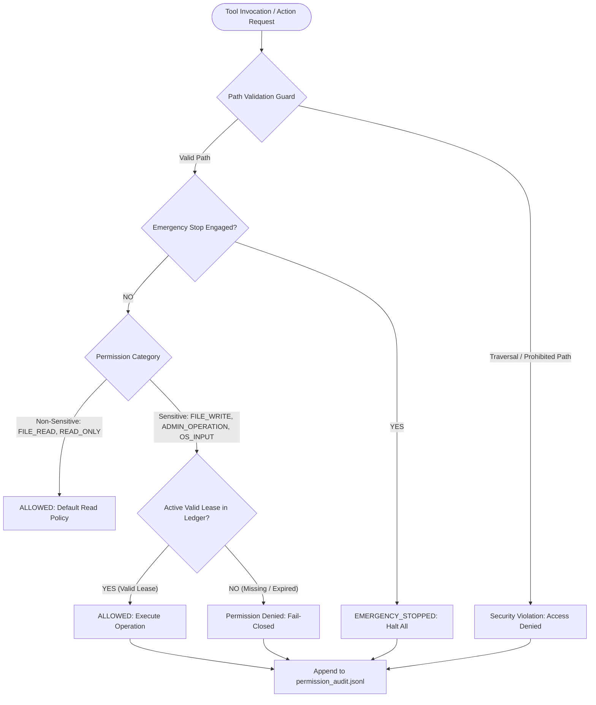

# MJ-X SECURITY LOCKDOWN — 03: PERMISSION ENFORCEMENT ARCHITECTURE

**Subsystem:** Permission Ledger Integration & Fail-Closed Access Control  
**Packages:** `mjx.security.permissions`, `actions.file_processor`, `core.self_modifier`  

---

## 1. ACCESS CONTROL MODEL

MJ-X enforces a least-privilege, capability-gated security model mediated by `PermissionManager` and the global `check_permission` interface.



---

## 2. INTEGRATION POINTS

### 2.1. File Processor (`actions/file_processor.py`)
- **Category Resolution:**
  - Non-destructive reads map to `PermissionCategory.FILE_READ`.
  - Mutating transformations (`resize`, `convert`, `compress`, `crop`, `reformat`, `fix`) map to `PermissionCategory.FILE_WRITE`.
- **Enforcement Logic:**
  ```python
  from mjx.security.permissions import check_permission, PermissionCategory
  req_category = PermissionCategory.FILE_WRITE if is_write else PermissionCategory.FILE_READ
  if not check_permission(
      req_category,
      action=action or ("write" if is_write else "read"),
      target=str(path),
      reason=f"FileProcessor {action or 'access'} on {path.name}",
  ):
      return f"Permission Denied: Operation '{action or 'access'}' on '{path.name}' rejected by security policy ({req_category.value})."
  ```

### 2.2. Codebase Self-Modifier (`core/self_modifier.py`)
- **Category Resolution:**
  - All modifications map to `PermissionCategory.ADMIN_OPERATION`.
- **Enforcement Logic:**
  - Gated behind `check_permission(PermissionCategory.ADMIN_OPERATION)`.
  - Permanent wildcards are prohibited for `ADMIN_OPERATION` (capped at 60s max lease duration).
  - Fails closed immediately if permission check raises or is denied.

---

## 3. AUDIT TRAIL LOGGING

Every grant, check, rejection, and emergency stop is recorded to the append-only ledger at `logs/permission_audit.jsonl` with ISO 8601 timestamps, category, action, target, decision, and rationale.
